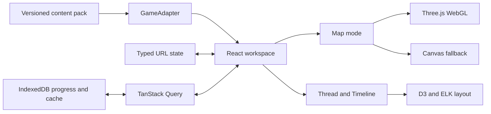

# Progression Atlas

Progression Atlas is a local-first visual companion for tracing story prerequisites, choices, discoveries, and rewards across a game world. The first vertical slice covers a schematic Qinghe data pack inspired by _Where Winds Meet_.

> Progression Atlas is an unofficial fan-made companion. It is not affiliated with, endorsed by, or a substitute for the game publisher or developer. Seed content is schematic and must not be presented as an authoritative walkthrough.

## Architecture



React owns controls, routing, selection, and accessibility. Three.js owns only the client map canvas. Thread and Timeline consume the same trace model, and IndexedDB persists both progress and the last valid content.

## Run locally

```bash
pnpm install --frozen-lockfile
pnpm dev
pnpm check
pnpm test:e2e
```

## Content and provenance

Every content pack is Zod-validated and versioned. Worlds, maps, layers, regions, threads, quests, steps, edges, discoveries, rewards, and locations carry a `sourceId`; every source declares a reference or local note, contributor, confidence, verification date, permission, and content version. Facts from multiple sources remain separate until reviewed. Coordinates use normalized map space (`0..1`) and must not imply surveyed geographic accuracy.

## Add a game

1. Implement `GameAdapter` under `src/features/atlas/content/<game>/adapter.ts`.
2. Add validated worlds, maps, layers, regions, threads, quests, steps, edges, locations, discoveries, rewards, and sources.
3. Register the adapter in `register-games.ts`.
4. Run `pnpm content:validate` and the adapter contract tests.

## Rebuild map assets

Place the reviewed source image at `public/games/<game>/maps/<map>/source.webp`, update the map manifest dimensions, and run:

```bash
pnpm map:build --game where-winds-meet
```

The command emits bounded raster levels plus a manifest. Commit the reviewed source, generated levels, and manifest together.

## Current limitation

The included Qinghe pack is a hand-reviewed schematic demonstration. Quest order, branch meaning, and coordinates require source-by-source verification before broader public use.

## Design and QA

- [Approved design specification](docs/superpowers/specs/2026-07-11-progression-atlas-design.md)
- [Visual fidelity ledger](docs/qa/progression-atlas-fidelity.md)

## Continue in another Codex session

The repository is designed to carry its own context across sessions:

- [Agent entry point](AGENTS.md)
- [Project goal, architecture, and current state](docs/PROJECT_CONTEXT.md)
- [Continuation roadmap](docs/ROADMAP.md)
- [Detailed continuation implementation plan](docs/superpowers/plans/2026-07-11-journey-continuation-plan.md)
- [Session handoff template](docs/SESSION_HANDOFF.md)
- [Completed foundation implementation plan](docs/superpowers/plans/2026-07-11-progression-atlas-implementation.md)

Start a new Codex session in `~/personal/journey` with:

> Read `AGENTS.md`, `docs/PROJECT_CONTEXT.md`, and `docs/ROADMAP.md`. Inspect `git status -sb` and the relevant source/tests. Summarize the current milestone and propose the smallest next testable task before editing.
