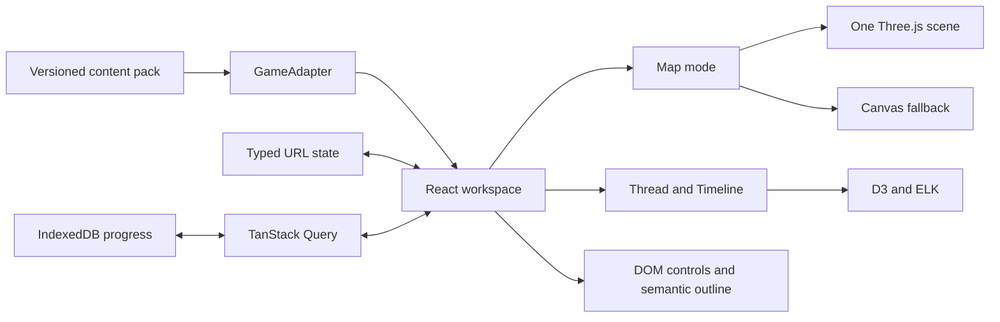

# Journey / Progression Atlas Project Context

Last reviewed: 2026-07-11

## Project identity

| Item                      | Value                                                       |
| ------------------------- | ----------------------------------------------------------- |
| Repository                | Journey                                                     |
| Product                   | Progression Atlas                                           |
| Local checkout            | `~/personal/journey`                                        |
| GitHub                    | `https://github.com/adriandarian/journey`                   |
| Default branch            | `main`                                                      |
| Current product phase     | Foundation vertical slice complete; platform expansion next |
| First game                | _Where Winds Meet_                                          |
| First region/content pack | Original schematic Qinghe demonstration                     |

Journey is the repository name. Progression Atlas is the platform’s user-facing name.

## The goal

Progression Atlas should become a multi-game visual companion for understanding and tracking open-world progression across space, dependencies, and narrative order.

Most game maps answer only **“where is this marker?”** Progression Atlas must answer:

- What happened before this step?
- What is currently available?
- What unlocks next?
- Which steps are optional, mutually exclusive, locked, or rejoined later?
- Where does a selected storyline travel through the world?
- Which lore, secrets, loot, events, rewards, and critical moments matter at this stage?
- How can a player follow a coherent route without losing the larger narrative context?

The primary artifact is an operational progression workspace, not a wiki, dashboard, static map, or playable recreation of the game.

## Product promise

A player selects a storyline and sees an ordered, branching, stateful journey synchronized across:

1. a spatial world map;
2. a dependency graph;
3. a narrative timeline;
4. a semantic outline and inspector;
5. local completion and branch-choice state;
6. a shareable URL representing the current workspace.

The interface must make progress meaning visible through text, shape, order, and state—not color alone.

## Current product slice

The implemented slice proves the final platform architecture with a representative _Where Winds Meet_ pack:

- one original 3840×2160 Qinghe-style map substrate;
- a representative 20-step main storyline;
- required, optional, choice, unlock, and rejoin relationships;
- completed, current, available, locked, and excluded progression states;
- linked lore, secrets, loot, rewards, events, and locations;
- Map, Thread, and Timeline modes;
- Trace Mode, step navigation, completion, and branch confirmation;
- search, filters, selection, zoom, reset, and copy-link controls;
- IndexedDB progress and local preferences;
- canonical URL recovery for obsolete or invalid entity IDs;
- WebGL rendering with Canvas2D fallback;
- desktop, portrait, and landscape layouts;
- reduced motion, keyboard operation, focus restoration, and axe checks;
- a 12,000-POI development stress fixture.

This content is intentionally schematic. It demonstrates the system’s behavior and must not be described as complete or authoritative game coverage.

## Architecture



### Ownership boundaries

| Layer                                | Owner                                  | Rule                                                               |
| ------------------------------------ | -------------------------------------- | ------------------------------------------------------------------ |
| Routes and shareable workspace state | TanStack Router                        | Search parameters are validated and canonicalized.                 |
| Async content/cache state            | TanStack Query                         | Fetch/cache state does not become renderer state.                  |
| Durable player state                 | IndexedDB repositories                 | Progress is local-first and versionable.                           |
| Small UI state                       | React                                  | Dialogs, sheets, search, and transient controls stay local.        |
| Map rendering                        | Three.js                               | One client-only scene and WebGL context, rendered on demand.       |
| Map fallback                         | Canvas2D                               | Mounted only when WebGL is unavailable or lost.                    |
| Route/graph math                     | D3 modules and ELK                     | Geometry only; no React lifecycle ownership.                       |
| Labels, inspector, accessibility     | React DOM and shadcn/ui                | Remains semantic and keyboard operable.                            |
| Motion                               | Anime.js plus narrow renderer playback | Motion cannot change data meaning and must respect reduced motion. |

### Multi-game boundary

`GameAdapter` is the extension seam. A new game supplies a manifest, validated content, map assets, search behavior, provenance, and optional capabilities. It must not fork the shell, progress engine, or renderers.

Current interface: `src/features/atlas/content/game-adapter.ts`.

## Repository map

```text
src/routes/                         TanStack Start routes and document shell
src/features/atlas/components/      responsive shell, commands, filters, inspector
src/features/atlas/content/         GameAdapter registry and game packs
src/features/atlas/model/           schemas, validation, coordinates
src/features/atlas/progress/        progress engine, IndexedDB, preferences, query cache
src/features/atlas/routing/         typed/canonical workspace search state
src/features/atlas/state/           shared committed selection
src/features/atlas/map/             trace model, DOM overlay, map viewport
src/features/atlas/map/three/       scene, surface, route, POI, picking, playback
src/features/atlas/map/canvas/      failure-only Canvas2D renderer
src/features/atlas/thread/          ELK dependency layout and graph UI
src/features/atlas/timeline/        ordered narrative timeline
public/games/                        reviewed map assets and generated tiles
scripts/                             deterministic asset tooling
tests/e2e/                           browser workflows and quality gates
docs/qa/                             renderer contract and fidelity evidence
docs/superpowers/specs/              approved product/design specification
docs/superpowers/plans/              completed and future executable plans
```

## Core data model

All relationships use stable opaque IDs; display labels are never keys.

The pack contains:

- manifest, worlds, maps, layers, and regions;
- threads, quests, steps, and dependency edges;
- locations, discoveries, and rewards;
- source/provenance records;
- normalized map coordinates in `[0,1] × [0,1]`.

Every factual record carries a `sourceId`. Source records retain contributor, confidence, verification date, permission, content version, and a reference or local note. Unknown facts remain unknown.

### Dependency meanings

- **required** — must be complete before the target is available;
- **optional** — a discoverable side path that does not falsely block the main route;
- **choice** — a mutually exclusive branch with explicit player confirmation;
- **rejoins** — branches converge at a later step;
- **unlocks/context** — non-linear availability or explanatory relationships.

The progress engine is deterministic. It must never silently complete excluded branches or allow a locked step to advance.

## Coordinate and rendering contract

The canonical content coordinate is normalized source-image space:

```text
normalized content coordinate
  -> source pixels
  -> orthographic world units
  -> camera/view transform
  -> CSS screen pixels
  -> Canvas device pixels when fallback is active
```

`src/features/atlas/model/coordinates.ts` is the sole transform authority. Map surfaces, route geometry, POIs, DOM labels, picking, Canvas, and tests must use it.

Renderer rules:

- exactly one Three.js scene and one WebGL context;
- on-demand rendering, with no ambient animation loop;
- device pixel ratio capped at 2 on desktop and 1.5 on mobile;
- Three.js/ELK chunks load lazily by mode;
- selected/rich DOM labels remain bounded as content grows;
- Canvas is failure-only, never a hidden duplicate renderer;
- hidden tabs pause scene work;
- reduced motion produces the final stable frame immediately.

## Visual and responsive rules

### Color semantics

- jade: primary route, completed, and current progression;
- muted gold: optional route;
- vermilion: exclusive choice or critical branch;
- neutral gray/brass: future and locked geometry;
- warm ivory: primary text;
- deep blue-black: rails, inspector, and application background.

### Composition

- **Desktop:** compact command bar, narrow left navigation, dominant map, right inspector.
- **Portrait:** compact game/utility bar, dominant map, persistent trace summary, bottom mode navigation, partial details sheet.
- **Landscape mobile:** dominant map with compact right inspector; full navigation rail collapses first.

The binding concept images are in `docs/superpowers/specs/assets/`. Approved deviations are recorded in `docs/qa/progression-atlas-fidelity.md`.

## Primary user workflows

### Trace a storyline

1. Select the game, region, and storyline.
2. Activate Trace story.
3. Inspect the first incomplete available step.
4. Move with Previous/Next or select a map/graph/timeline node.
5. Review prerequisites, rewards, linked discoveries, and source confidence.
6. Complete a valid step or confirm a choice.
7. Observe downstream availability recompute across every mode.
8. Copy the URL to share the view; local progress remains local.

### Recover a link

Valid URL state overrides view defaults. Invalid entity IDs fall back to the nearest valid parent, update to a canonical URL, and show a concise recovery notice without blanking the atlas.

### Work offline or without WebGL

The last valid content and progress remain readable. WebGL failure activates Canvas2D with the same trace and semantic outline. A failure notice is non-blocking.

## Verification baseline

As of 2026-07-11, the verified release gate includes:

- 21 Vitest files and 33 unit/component tests;
- content-pack validation;
- deterministic map-pyramid rebuild;
- ESLint and TypeScript checks;
- production client and SSR builds;
- Playwright projects at 1568×1003, 432×911, and 940×418;
- accessibility, URL recovery, progress persistence, WebGL readiness, Canvas fallback, responsive composition, reduced motion, and a 12,000-POI fixture.

Commands:

```bash
pnpm check
pnpm test:coverage
pnpm test:e2e
```

Do not preserve the numeric test count as a success criterion; it is a dated baseline and should increase as behavior grows.

## Locked decisions

1. The repository is Journey; the product remains Progression Atlas.
2. The app is multi-game from the data boundary, even while only one game is populated.
3. The map is the primary evidence surface.
4. React owns the application; renderer objects stay outside application state.
5. Three.js is the focal renderer; Canvas2D is failure-only.
6. D3 and ELK own geometry/layout, not component lifecycle.
7. The map asset and seed content are original and schematic.
8. Provenance is part of the data model and visible product experience.
9. URL state is shareable; player progress is not silently imported by a link.
10. Accounts, remote sync, comments, moderation, and a general CMS are deferred.
11. A Gantt chart is not appropriate; narrative order is not calendar duration.
12. p5.js is excluded from the primary renderer because it duplicates existing responsibilities.

## Known limitations

- Only the schematic Qinghe demonstration is populated.
- Quest ordering, coordinates, and branch meanings are not authoritative game guidance.
- The generated map pyramid exists, but the current Three.js surface still loads the reviewed source image rather than streaming visible tiles by zoom.
- The ELK Thread chunk is large and remains lazy-loaded; bundle reduction is desirable before broad deployment.
- Content is authored in TypeScript seed files rather than through a dedicated authoring tool.
- Search and outlines are adequate for the first slice but are not yet proven against complete-world data.
- There is no hosted deployment pipeline, account system, cross-device sync, annotation model, or moderation system.
- Manual VoiceOver, forced-colors, real mobile-device gesture, and representative-hardware frame pacing checks remain release tasks for a public launch.

## Recommended continuation order

1. Add CI and a reproducible production deployment target.
2. Externalize content packs and add authoring/validation tooling.
3. Connect the tile pyramid to viewport-aware map loading.
4. Prove large-pack search, virtualization, and performance budgets.
5. Expand _Where Winds Meet_ only from lawful, reviewed sources.
6. Add local annotations and saved views.
7. Add a second small game pack to prove the adapter boundary.
8. Consider accounts and remote sync only after local data migration/export is stable.

The executable milestone plan is `docs/ROADMAP.md`.

## Starting a new Codex session

Open the repository at `~/personal/journey` and use this prompt:

> Read `AGENTS.md`, `docs/PROJECT_CONTEXT.md`, and `docs/ROADMAP.md`. Inspect `git status -sb` and the relevant source/tests. Summarize the current milestone and propose the smallest next testable task before editing.

Then run:

```bash
git status -sb
git log -5 --oneline
pnpm install --frozen-lockfile
pnpm test
```

## Ending a session

Before handing work to another session:

1. update this document if capability, architecture, limitations, or locked decisions changed;
2. update `docs/ROADMAP.md` milestone state;
3. run the proportional verification commands;
4. record the branch, commit, changed files, test results, open risks, and exact next action using `docs/SESSION_HANDOFF.md`;
5. never rely on chat history as the only source of project state.
