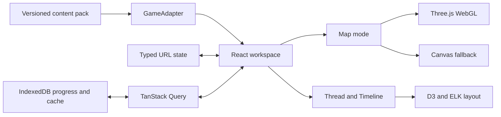

# Progression Atlas Implementation Plan

Status: Completed foundation execution plan. This document preserves the original task sequence and may contain historical dependency or path references; current operating context lives in `AGENTS.md`, `docs/PROJECT_CONTEXT.md`, and `docs/ROADMAP.md`.

> **For agentic workers:** REQUIRED SUB-SKILL: Use superpowers:subagent-driven-development (recommended) or superpowers:executing-plans to implement this plan task-by-task. Steps use checkbox (- [ ]) syntax for tracking.

**Goal:** Build the approved multi-game progression atlas with a complete Where Winds Meet vertical slice, synchronized Map, Thread, and Timeline modes, Trace Mode, local progress, shareable state, responsive layouts, and verified renderer fallbacks.

**Architecture:** TanStack Start and React own routing, data loading, responsive application structure, and code-native UI. One client-only Three.js scene owns the focal map; D3 modules and ELK own route and dependency geometry; IndexedDB owns durable local progress; Canvas2D provides a real fallback rather than a duplicate renderer.

**Tech Stack:** Node 22.23.0, pnpm 10.18.2, React 19.2.7, TanStack Start 1.168.27, TanStack Router 1.170.17, TanStack Query 5.101.2 plus React Query persistence 5.101.2, TanStack Virtual 3.14.5, TypeScript 7.0.2, Vite 8.1.4, Tailwind CSS 4.3.2, shadcn 4.13.0 with Radix primitives, Three.js 0.185.1, D3 modules, ELK 0.11.1, Anime.js 4.5.0, Zod 4.4.3, idb 8.0.3, rbush 4.0.1, Vitest 4.1.10, Playwright 1.61.1.

## Global Constraints

- Pin every direct dependency to the exact versions listed above; commit pnpm-lock.yaml.
- Do not use React Server Components; TanStack Start server functions and ordinary React client boundaries are sufficient.
- Keep React application state free of Three.js, Canvas, and DOM node objects.
- Keep exactly one focal renderer mounted: Three.js when healthy, Canvas2D only after WebGL failure.
- Use normalized source coordinates in the inclusive range 0–1 and one reversible transform for every renderer, label, hit test, and export.
- Use original schematic map art and manually authored, provenance-bearing data; do not scrape or copy official or third-party maps.
- Preserve the approved desktop tri-pane, portrait map-plus-sheet, and landscape map-plus-compact-inspector compositions.
- Preserve Map, Thread, Timeline, Trace Mode, jade primary route, vermilion branch, neutral locked state, and code-native text.
- Do not ship inert controls, unfinished boxes, rough generated data, decorative particles, ambient motion, or color-only state.
- Every feature task follows red-green-refactor: failing test, observed failure, minimal implementation, passing test, focused commit.
- Required progression edges form a DAG; recurring events live outside that graph.
- User progress is local-first and never overwritten by incoming URL state.
- Reduced-motion mode renders immediate stable states; it is not a slower animation.

---

## Planned file structure

### Root and toolchain

- **package.json** — pinned packages and dev/build/test/check scripts.
- **pnpm-lock.yaml** — committed dependency resolution.
- **vite.config.ts** — TanStack Start, React, Tailwind, and path alias configuration.
- **vitest.config.ts** — unit/component test projects and coverage.
- **playwright.config.ts** — desktop, portrait, and landscape projects.
- **components.json** — shadcn Radix Nova configuration.
- **scripts/build-map-pyramid.mjs** — deterministic source-image-to-WebP tile pipeline.

### Application

- **src/router.tsx** — router, QueryClient, and SSR query integration.
- **src/routes/__root.tsx** — document shell, metadata, styles, error boundary.
- **src/routes/index.tsx** — redirect to the default game workspace.
- **src/routes/games/$gameSlug.tsx** — validated URL workspace and game adapter loading.
- **src/styles/app.css** — semantic tokens, typography, layout, focus, and responsive rules.
- **src/test/setup.ts** — DOM, IndexedDB, ResizeObserver, matchMedia, and cleanup fixtures.

### Domain and content

- **src/features/atlas/model/schema.ts** — Zod schemas and inferred domain types.
- **src/features/atlas/model/validate-content-pack.ts** — reference, DAG, coordinate, and provenance validation.
- **src/features/atlas/model/coordinates.ts** — reversible normalized/world/screen transforms.
- **src/features/atlas/content/game-adapter.ts** — multi-game adapter contract and registry.
- **src/features/atlas/content/where-winds-meet/seed-pack.ts** — reviewed 20-step schematic content pack.
- **src/features/atlas/content/where-winds-meet/adapter.ts** — Where Winds Meet adapter.
- **public/games/where-winds-meet/maps/qinghe/map-manifest.json** — dimensions, bounds, and tile levels.
- **public/games/where-winds-meet/maps/qinghe/source.webp** — original production map substrate.
- **public/games/where-winds-meet/maps/qinghe/tiles/** — generated tile pyramid.
- **public/games/where-winds-meet/maps/qinghe/source-metadata.json** — generation prompt and provenance.

### Progress, persistence, and routing

- **src/features/atlas/progress/progress-engine.ts** — derived availability, choices, exclusion, and completion.
- **src/features/atlas/progress/progress-repository.ts** — IndexedDB schema and repository.
- **src/features/atlas/progress/use-progress.ts** — Query-backed progress operations.
- **src/features/atlas/progress/preferences-repository.ts** — local compact UI preferences.
- **src/features/atlas/routing/workspace-search.ts** — URL schema, normalization, defaults, and serialization.
- **src/features/atlas/state/atlas-selection.tsx** — committed selection shared across modes.

### Product shell and views

- **src/features/atlas/components/app-shell.tsx** — responsive shell composition.
- **src/features/atlas/components/game-selector.tsx** — adapter-backed game switching.
- **src/features/atlas/components/top-command-bar.tsx** — game, mode, search, and utility controls.
- **src/features/atlas/components/navigation-rail.tsx** — region, storyline, filters, progress.
- **src/features/atlas/components/story-inspector.tsx** — selected step, prerequisites, rewards, sources.
- **src/features/atlas/components/mobile-inspector-sheet.tsx** — portrait and landscape detail surfaces.
- **src/features/atlas/components/search-command.tsx** — search and keyboard navigation.
- **src/features/atlas/components/offline-status.tsx** — cached/stale/offline/partial state.

### Visualization

- **src/features/atlas/map/map-viewport.tsx** — renderer boundary, overlays, controls, readiness.
- **src/features/atlas/map/map-overlay.tsx** — selected DOM labels and accessible summary.
- **src/features/atlas/map/three/scene-controller.ts** — Three lifecycle and on-demand rendering.
- **src/features/atlas/map/three/map-surface.ts** — tile plane and texture disposal.
- **src/features/atlas/map/three/route-layer.ts** — route ribbons, nodes, branch state, animation progress.
- **src/features/atlas/map/three/poi-layer.ts** — instanced POIs and visibility.
- **src/features/atlas/map/three/picker.ts** — screen-space spatial index and nearest selection.
- **src/features/atlas/map/three/trace-playback-controller.ts** — single cancellable scene animation clock.
- **src/features/atlas/map/canvas/canvas-map.ts** — Canvas2D fallback renderer.
- **src/features/atlas/thread/thread-graph.tsx** — ELK layout and SVG rendering.
- **src/features/atlas/timeline/narrative-timeline.tsx** — ordered progression and branch sequence.

### Tests

- Unit and component tests live beside source as **\*.test.ts** or **\*.test.tsx**.
- **tests/e2e/atlas-workspace.spec.ts** — core workflow and URL restoration.
- **tests/e2e/responsive.spec.ts** — viewport and mobile-panel behavior.
- **tests/e2e/fallbacks.spec.ts** — WebGL, offline, invalid URL, and persistence failures.
- **tests/e2e/accessibility.spec.ts** — keyboard, reduced motion, and axe checks.
- **tests/e2e/performance.spec.ts** — context ownership, lazy loading, DPR, pause, and stress budgets.

---

### Task 1: Scaffold the pinned TanStack application and test harness

**Files:**
- Create: package.json, pnpm-lock.yaml, .npmrc, vite.config.ts, tsconfig.json, eslint.config.js
- Create: vitest.config.ts, playwright.config.ts, src/test/setup.ts
- Modify: .gitignore
- Test: src/routes/index.test.tsx

**Interfaces:**
- Consumes: approved design specification and the existing Git repository.
- Produces: pnpm scripts dev, build, test, test:e2e, lint, typecheck, check; path alias @/*; jsdom and Playwright test environments.

- [ ] **Step 1: Scaffold outside the repository root and merge safely**

Run:

~~~bash
TANSTACK_CLI_TELEMETRY_DISABLED=1 pnpm dlx @tanstack/cli@0.69.5 create progression-atlas \
  --framework React \
  --package-manager pnpm \
  --toolchain eslint \
  --no-examples \
  --no-install \
  --no-git \
  --no-intent \
  --add-ons tanstack-query \
  --target-dir work/tanstack-scaffold \
  --yes
rsync -a --exclude=.git --exclude=.gitignore work/tanstack-scaffold/ ./
~~~

Expected: the TanStack Start source files appear at the repository root; docs, outputs, work, and the existing .git directory remain unchanged.

- [ ] **Step 2: Install exact runtime and test dependencies**

Create **.npmrc** first so later shadcn additions are exact too:

~~~ini
save-exact=true
~~~

Run:

~~~bash
pnpm add --save-exact \
  react@19.2.7 react-dom@19.2.7 \
  @tanstack/react-start@1.168.27 \
  @tanstack/react-router@1.170.17 \
  @tanstack/react-query@5.101.2 \
  @tanstack/react-query-persist-client@5.101.2 \
  @tanstack/query-persist-client-core@5.101.2 \
  @tanstack/react-virtual@3.14.5 \
  @tanstack/react-devtools@0.10.8 \
  @tanstack/react-query-devtools@5.101.2 \
  @tanstack/react-router-devtools@1.167.0 \
  @tanstack/react-router-ssr-query@1.167.1 \
  @tanstack/router-plugin@1.168.19 \
  @tailwindcss/vite@4.3.2 tailwindcss@4.3.2 lucide-react@1.24.0 \
  three@0.185.1 d3-array@3.2.4 d3-scale@4.0.2 \
  d3-shape@3.2.0 d3-interpolate@3.0.1 \
  elkjs@0.11.1 animejs@4.5.0 idb@8.0.3 zod@4.4.3 rbush@4.0.1
pnpm add -D --save-exact \
  vite@8.1.4 typescript@7.0.2 vitest@4.1.10 \
  @vitest/coverage-v8@4.1.10 jsdom@29.1.1 \
  @playwright/test@1.61.1 @axe-core/playwright@4.12.1 \
  @testing-library/dom@10.4.1 @testing-library/jest-dom@6.9.1 \
  @testing-library/react@16.3.2 @testing-library/user-event@14.6.1 \
  @tailwindcss/typography@0.5.20 @tanstack/devtools-vite@0.8.1 \
  @tanstack/eslint-config@0.4.0 @tanstack/router-cli@1.167.18 \
  @vitejs/plugin-react@6.0.3 eslint@10.7.0 prettier@3.9.5 \
  @types/node@26.1.1 @types/react@19.2.17 @types/react-dom@19.2.3 \
  @types/d3-array@3.2.2 @types/d3-scale@4.0.9 \
  @types/d3-shape@3.1.8 @types/d3-interpolate@3.0.4 \
  fake-indexeddb@6.2.5 sharp@0.35.3 \
  @types/three@0.185.1 @types/rbush@4.0.0
~~~

Expected: pnpm installs without peer dependency errors and writes pnpm-lock.yaml.

- [ ] **Step 3: Add the first failing route smoke test**

Create **src/routes/index.test.tsx**:

~~~tsx
import { render, screen } from '@testing-library/react'
import { describe, expect, it } from 'vitest'
import { IndexScreen } from './index'

describe('IndexScreen', () => {
  it('identifies the product and default game', () => {
    render(<IndexScreen />)
    expect(screen.getByRole('heading', { name: 'Progression Atlas' })).toBeVisible()
    expect(screen.getByText('Where Winds Meet')).toBeVisible()
  })
})
~~~

Run:

~~~bash
pnpm vitest run src/routes/index.test.tsx
~~~

Expected: FAIL because IndexScreen is not exported and the approved shell is not rendered.

- [ ] **Step 4: Configure tests and implement the minimal route screen**

Create **vitest.config.ts**:

~~~ts
import { defineConfig } from 'vitest/config'
import { fileURLToPath, URL } from 'node:url'

export default defineConfig({
  resolve: { alias: { '@': fileURLToPath(new URL('./src', import.meta.url)) } },
  test: {
    environment: 'jsdom',
    setupFiles: ['./src/test/setup.ts'],
    coverage: { provider: 'v8', reporter: ['text', 'html'] },
  },
})
~~~

Create **src/test/setup.ts**:

~~~ts
import '@testing-library/jest-dom/vitest'
import 'fake-indexeddb/auto'
import { cleanup } from '@testing-library/react'
import { afterEach, vi } from 'vitest'

afterEach(cleanup)

class ResizeObserverMock {
  observe() {}
  unobserve() {}
  disconnect() {}
}

vi.stubGlobal('ResizeObserver', ResizeObserverMock)
vi.stubGlobal('matchMedia', (query: string) => ({
  matches: false,
  media: query,
  onchange: null,
  addEventListener: vi.fn(),
  removeEventListener: vi.fn(),
  addListener: vi.fn(),
  removeListener: vi.fn(),
  dispatchEvent: vi.fn(),
}))
~~~

Replace the generated index route body with:

~~~tsx
import { createFileRoute } from '@tanstack/react-router'

export const Route = createFileRoute('/')({ component: IndexScreen })

export function IndexScreen() {
  return (
    <main>
      <h1>Progression Atlas</h1>
      <p>Where Winds Meet</p>
    </main>
  )
}
~~~

- [ ] **Step 5: Add deterministic scripts and verify the baseline**

Set package.json scripts to:

~~~json
{
  "scripts": {
    "dev": "vite dev",
    "build": "vite build",
    "preview": "vite preview",
    "test": "vitest run",
    "test:watch": "vitest",
    "test:coverage": "vitest run --coverage",
    "test:e2e": "playwright test",
    "lint": "eslint .",
    "typecheck": "tsc --noEmit",
    "check": "pnpm lint && pnpm typecheck && pnpm test && pnpm build"
  }
}
~~~

Run:

~~~bash
pnpm test
pnpm typecheck
pnpm build
~~~

Expected: one passing smoke test, zero TypeScript errors, and a successful production build.

- [ ] **Step 6: Commit**

~~~bash
git add package.json pnpm-lock.yaml .npmrc vite.config.ts tsconfig.json eslint.config.js vitest.config.ts src .gitignore
git commit -m "build: scaffold progression atlas"
~~~

---

### Task 2: Define and validate the multi-game content contract

**Files:**
- Create: src/features/atlas/model/schema.ts
- Create: src/features/atlas/model/validate-content-pack.ts
- Test: src/features/atlas/model/schema.test.ts
- Test: src/features/atlas/model/validate-content-pack.test.ts

**Interfaces:**
- Consumes: Zod 4.4.3.
- Produces: ContentPack, QuestStep, DependencyEdge, ProgressState, SourceRecord, parseContentPack(input), validateContentPack(pack).

- [ ] **Step 1: Write failing schema and graph-validation tests**

Create **src/features/atlas/model/schema.test.ts**:

~~~ts
import { describe, expect, it } from 'vitest'
import { parseContentPack } from './schema'

describe('parseContentPack', () => {
  it('rejects out-of-bounds normalized coordinates', () => {
    expect(() =>
      parseContentPack({
        manifest: {
          id: 'wwm', slug: 'where-winds-meet', title: 'Where Winds Meet', version: 1,
          adapterVersion: 1, capabilities: ['worlds', 'layers'],
          theme: { primary: '#65c5a8', branch: '#d86c4a' },
          attribution: 'Original schematic content', disclaimer: 'Unofficial companion',
        },
        worlds: [{ id: 'qinghe', title: 'Qinghe', sourceId: 'source-1' }],
        maps: [{
          id: 'qinghe', worldId: 'qinghe', width: 3840, height: 2160, imageUrl: '/map.webp',
          coordinateSystem: 'normalized-image', tileManifestUrl: '/tiles.json', layerIds: ['surface'], sourceId: 'source-1',
        }],
        regions: [],
        layers: [{ id: 'surface', mapId: 'qinghe', title: 'Surface', kind: 'surface', sourceId: 'source-1' }],
        locations: [{ id: 'ferry', mapId: 'qinghe', point: { x: 1.2, y: 0.5 }, sourceId: 'source-1' }],
        threads: [],
        quests: [],
        steps: [],
        edges: [],
        discoveries: [],
        sources: [{
          id: 'source-1', kind: 'user-authored', reference: 'Schema test fixture', contributor: 'Tests',
          confidence: 'schematic', verifiedAt: '2026-07-11', permission: 'Original fixture', contentVersion: 1,
        }],
      }),
    ).toThrow()
  })
})
~~~

Create **src/features/atlas/model/validate-content-pack.test.ts**:

~~~ts
import { describe, expect, it } from 'vitest'
import { validateContentPack } from './validate-content-pack'
import { makePack } from '../test/make-pack'

describe('validateContentPack', () => {
  it('reports a cycle in required progression edges', () => {
    const pack = makePack({
      edges: [
        { id: 'a-b', from: 'a', to: 'b', kind: 'required' },
        { id: 'b-a', from: 'b', to: 'a', kind: 'required' },
      ],
    })
    expect(validateContentPack(pack).errors).toContain('Required progression contains a cycle: a -> b -> a')
  })

  it('rejects a choice group with no alternative', () => {
    const pack = makePack({
      edges: [{ id: 'a-b', from: 'a', to: 'b', kind: 'choice', choiceGroup: 'road' }],
    })
    expect(validateContentPack(pack).errors).toContain('Choice group requires at least two branches: road')
  })
})
~~~

Run:

~~~bash
pnpm vitest run src/features/atlas/model
~~~

Expected: FAIL because the schemas, validator, and fixture do not exist.

- [ ] **Step 2: Implement exact Zod schemas**

Create **src/features/atlas/model/schema.ts**:

~~~ts
import { z } from 'zod'

export const normalizedPointSchema = z.object({
  x: z.number().min(0).max(1),
  y: z.number().min(0).max(1),
})

export const sourceRecordSchema = z.object({
  id: z.string().min(1),
  kind: z.enum(['manually-observed', 'user-authored', 'licensed', 'official-reference', 'inferred']),
  reference: z.string().min(1),
  contributor: z.string().min(1),
  verifiedAt: z.iso.date(),
  confidence: z.enum(['exact', 'approximate', 'schematic', 'unverified']),
  permission: z.string().min(1),
  contentVersion: z.number().int().positive(),
})

export const dependencyKindSchema = z.enum(['required', 'optional', 'choice', 'unlocks', 'rejoins', 'context'])
export const progressStateSchema = z.enum(['unseen', 'discovered', 'available', 'current', 'completed', 'locked', 'missed', 'excluded'])

export const contentPackSchema = z.object({
  manifest: z.object({
    id: z.string().min(1),
    slug: z.string().min(1),
    title: z.string().min(1),
    version: z.number().int().positive(),
    adapterVersion: z.number().int().positive(),
    capabilities: z.array(z.enum(['worlds', 'layers', 'regions', 'threads', 'discoveries'])),
    theme: z.object({ primary: z.string().min(1), branch: z.string().min(1) }),
    attribution: z.string().min(1),
    disclaimer: z.string().min(1),
  }),
  worlds: z.array(z.object({
    id: z.string().min(1),
    title: z.string().min(1),
    sourceId: z.string().min(1),
  })).min(1),
  maps: z.array(z.object({
    id: z.string().min(1),
    worldId: z.string().min(1),
    width: z.number().int().positive(),
    height: z.number().int().positive(),
    imageUrl: z.string().min(1),
    coordinateSystem: z.literal('normalized-image'),
    tileManifestUrl: z.string().min(1),
    layerIds: z.array(z.string()).min(1),
    sourceId: z.string().min(1),
  })).min(1),
  regions: z.array(z.object({
    id: z.string().min(1),
    worldId: z.string().min(1),
    mapId: z.string().min(1),
    title: z.string().min(1),
    bounds: z.array(normalizedPointSchema).min(3).optional(),
    sourceId: z.string().min(1),
  })),
  layers: z.array(z.object({
    id: z.string().min(1),
    mapId: z.string().min(1),
    title: z.string().min(1),
    kind: z.enum(['surface', 'underground', 'interior', 'dream', 'other']),
    sourceId: z.string().min(1),
  })).min(1),
  locations: z.array(z.object({
    id: z.string().min(1),
    mapId: z.string().min(1),
    label: z.string().optional(),
    point: normalizedPointSchema,
    sourceId: z.string().min(1),
  })),
  threads: z.array(z.object({
    id: z.string().min(1),
    title: z.string().min(1),
    kind: z.enum(['main', 'side', 'wandering', 'character', 'faction', 'event']),
    stepIds: z.array(z.string()),
    sourceId: z.string().min(1),
  })),
  quests: z.array(z.object({
    id: z.string().min(1),
    threadId: z.string().min(1),
    title: z.string().min(1),
    stepIds: z.array(z.string()).min(1),
    sourceId: z.string().min(1),
  })),
  steps: z.array(z.object({
    id: z.string().min(1),
    threadId: z.string().min(1),
    title: z.string().min(1),
    summary: z.string().min(1),
    locationId: z.string().optional(),
    rewardIds: z.array(z.string()).default([]),
    sourceId: z.string().min(1),
  })),
  edges: z.array(z.object({
    id: z.string().min(1),
    from: z.string().min(1),
    to: z.string().min(1),
    kind: dependencyKindSchema,
    route: z.array(normalizedPointSchema).optional(),
    choiceGroup: z.string().optional(),
    sourceId: z.string().min(1),
  })),
  discoveries: z.array(z.object({
    id: z.string().min(1),
    title: z.string().min(1),
    kind: z.enum(['lore', 'secret', 'loot', 'puzzle', 'boss', 'merchant', 'abode', 'event']),
    locationId: z.string().min(1),
    relevantStepIds: z.array(z.string()),
    sourceId: z.string().min(1),
  })),
  rewards: z.array(z.object({
    id: z.string().min(1),
    title: z.string().min(1),
    kind: z.enum(['item', 'currency', 'ability', 'unlock', 'reputation', 'outcome']),
    sourceId: z.string().min(1),
  })).default([]),
  sources: z.array(sourceRecordSchema).min(1),
})

export type ContentPack = z.infer<typeof contentPackSchema>
export type QuestStep = ContentPack['steps'][number]
export type DependencyEdge = ContentPack['edges'][number]
export type ProgressState = z.infer<typeof progressStateSchema>
export type SourceRecord = z.infer<typeof sourceRecordSchema>

export function parseContentPack(input: unknown): ContentPack {
  return contentPackSchema.parse(input)
}
~~~

- [ ] **Step 3: Add the focused pack factory used by tests**

Create **src/features/atlas/test/make-pack.ts**:

~~~ts
import { parseContentPack, type ContentPack, type DependencyEdge } from '../model/schema'

type PackOverrides = Omit<Partial<ContentPack>, 'edges'> & {
  edges?: Array<Omit<DependencyEdge, 'sourceId'> & { sourceId?: string }>
}

export function makePack(overrides: PackOverrides = {}): ContentPack {
  const base: ContentPack = {
    manifest: {
      id: 'test', slug: 'test', title: 'Test Game', version: 1, adapterVersion: 1,
      capabilities: ['worlds', 'layers', 'regions', 'threads', 'discoveries'],
      theme: { primary: '#65c5a8', branch: '#d86c4a' },
      attribution: 'Original test fixture', disclaimer: 'Test data only',
    },
    worlds: [{ id: 'world', title: 'World', sourceId: 'source' }],
    maps: [{
      id: 'map', worldId: 'world', width: 1000, height: 1000, imageUrl: '/map.webp',
      coordinateSystem: 'normalized-image', tileManifestUrl: '/tiles.json', layerIds: ['surface'], sourceId: 'source',
    }],
    regions: [{ id: 'region', worldId: 'world', mapId: 'map', title: 'Region', sourceId: 'source' }],
    layers: [{ id: 'surface', mapId: 'map', title: 'Surface', kind: 'surface', sourceId: 'source' }],
    locations: [],
    threads: [{ id: 'main', title: 'Main', kind: 'main', stepIds: ['a', 'b'], sourceId: 'source' }],
    quests: [{ id: 'quest', threadId: 'main', title: 'Quest', stepIds: ['a', 'b'], sourceId: 'source' }],
    steps: [
      { id: 'a', threadId: 'main', title: 'A', summary: 'First', rewardIds: [], sourceId: 'source' },
      { id: 'b', threadId: 'main', title: 'B', summary: 'Second', rewardIds: [], sourceId: 'source' },
    ],
    edges: [{ id: 'a-b', from: 'a', to: 'b', kind: 'required', sourceId: 'source' }],
    discoveries: [],
    rewards: [],
    sources: [{
      id: 'source', kind: 'user-authored', reference: 'Test fixture', contributor: 'Tests',
      confidence: 'schematic', verifiedAt: '2026-07-11', permission: 'Original fixture', contentVersion: 1,
    }],
  }
  const edges = (overrides.edges ?? base.edges).map((edge) => ({ ...edge, sourceId: edge.sourceId ?? 'source' }))
  return parseContentPack({ ...base, ...overrides, edges })
}
~~~

- [ ] **Step 4: Implement referential and DAG validation**

Create **src/features/atlas/model/validate-content-pack.ts** with:

~~~ts
import type { ContentPack } from './schema'

export interface ValidationReport {
  errors: string[]
  warnings: string[]
}

export function validateContentPack(pack: ContentPack): ValidationReport {
  const errors: string[] = []
  const warnings: string[] = []
  const stepIds = new Set(pack.steps.map((step) => step.id))
  const sourceIds = new Set(pack.sources.map((source) => source.id))
  const mapIds = new Set(pack.maps.map((map) => map.id))
  const worldIds = new Set(pack.worlds.map((world) => world.id))
  const layerIds = new Set(pack.layers.map((layer) => layer.id))
  const locationIds = new Set(pack.locations.map((location) => location.id))
  const threadIds = new Set(pack.threads.map((thread) => thread.id))
  const rewardIds = new Set(pack.rewards.map((reward) => reward.id))

  function reportDuplicates(label: string, values: string[]) {
    const seen = new Set<string>()
    for (const value of values) {
      if (seen.has(value)) errors.push('Duplicate ' + label + ' id: ' + value)
      seen.add(value)
    }
  }

  reportDuplicates('step', pack.steps.map((item) => item.id))
  reportDuplicates('edge', pack.edges.map((item) => item.id))
  reportDuplicates('location', pack.locations.map((item) => item.id))
  reportDuplicates('discovery', pack.discoveries.map((item) => item.id))
  reportDuplicates('world', pack.worlds.map((item) => item.id))
  reportDuplicates('map', pack.maps.map((item) => item.id))
  reportDuplicates('layer', pack.layers.map((item) => item.id))
  reportDuplicates('region', pack.regions.map((item) => item.id))
  reportDuplicates('thread', pack.threads.map((item) => item.id))
  reportDuplicates('quest', pack.quests.map((item) => item.id))
  reportDuplicates('reward', pack.rewards.map((item) => item.id))
  reportDuplicates('source', pack.sources.map((item) => item.id))

  for (const world of pack.worlds) {
    if (!sourceIds.has(world.sourceId)) errors.push('Unknown source ' + world.sourceId + ' for world ' + world.id)
  }
  for (const map of pack.maps) {
    if (!worldIds.has(map.worldId)) errors.push('Unknown world ' + map.worldId + ' for map ' + map.id)
    if (!sourceIds.has(map.sourceId)) errors.push('Unknown source ' + map.sourceId + ' for map ' + map.id)
    for (const layerId of map.layerIds) if (!layerIds.has(layerId)) errors.push('Unknown layer ' + layerId + ' for map ' + map.id)
  }
  for (const layer of pack.layers) {
    if (!mapIds.has(layer.mapId)) errors.push('Unknown map ' + layer.mapId + ' for layer ' + layer.id)
    if (!sourceIds.has(layer.sourceId)) errors.push('Unknown source ' + layer.sourceId + ' for layer ' + layer.id)
  }
  for (const region of pack.regions) {
    if (!worldIds.has(region.worldId)) errors.push('Unknown world ' + region.worldId + ' for region ' + region.id)
    if (!mapIds.has(region.mapId)) errors.push('Unknown map ' + region.mapId + ' for region ' + region.id)
    if (!sourceIds.has(region.sourceId)) errors.push('Unknown source ' + region.sourceId + ' for region ' + region.id)
  }

  for (const location of pack.locations) {
    if (!mapIds.has(location.mapId)) errors.push('Unknown map ' + location.mapId + ' for location ' + location.id)
    if (!sourceIds.has(location.sourceId)) errors.push('Unknown source ' + location.sourceId + ' for location ' + location.id)
  }

  for (const step of pack.steps) {
    if (!sourceIds.has(step.sourceId)) errors.push('Unknown source ' + step.sourceId + ' for step ' + step.id)
    if (!threadIds.has(step.threadId)) errors.push('Unknown thread ' + step.threadId + ' for step ' + step.id)
    if (step.locationId && !locationIds.has(step.locationId)) errors.push('Unknown location ' + step.locationId + ' for step ' + step.id)
    for (const rewardId of step.rewardIds) {
      if (!rewardIds.has(rewardId)) errors.push('Unknown reward ' + rewardId + ' for step ' + step.id)
    }
  }

  for (const thread of pack.threads) {
    if (!sourceIds.has(thread.sourceId)) errors.push('Unknown source ' + thread.sourceId + ' for thread ' + thread.id)
    for (const stepId of thread.stepIds) {
      if (!stepIds.has(stepId)) errors.push('Unknown step ' + stepId + ' in thread ' + thread.id)
    }
  }

  for (const quest of pack.quests) {
    if (!threadIds.has(quest.threadId)) errors.push('Unknown thread ' + quest.threadId + ' for quest ' + quest.id)
    if (!sourceIds.has(quest.sourceId)) errors.push('Unknown source ' + quest.sourceId + ' for quest ' + quest.id)
    for (const stepId of quest.stepIds) if (!stepIds.has(stepId)) errors.push('Unknown step ' + stepId + ' for quest ' + quest.id)
  }

  for (const edge of pack.edges) {
    if (!stepIds.has(edge.from) || !stepIds.has(edge.to)) errors.push('Unknown step reference in edge ' + edge.id)
    if (!sourceIds.has(edge.sourceId)) errors.push('Unknown source ' + edge.sourceId + ' for edge ' + edge.id)
    if (edge.kind === 'choice' && !edge.choiceGroup) errors.push('Choice edge requires choiceGroup: ' + edge.id)
  }
  const choiceGroups = new Map<string, number>()
  for (const edge of pack.edges.filter((item) => item.kind === 'choice' && item.choiceGroup)) {
    choiceGroups.set(edge.choiceGroup!, (choiceGroups.get(edge.choiceGroup!) ?? 0) + 1)
  }
  for (const [group, count] of choiceGroups) {
    if (count < 2) errors.push('Choice group requires at least two branches: ' + group)
  }

  for (const discovery of pack.discoveries) {
    if (!locationIds.has(discovery.locationId)) errors.push('Unknown location ' + discovery.locationId + ' for discovery ' + discovery.id)
    if (!sourceIds.has(discovery.sourceId)) errors.push('Unknown source ' + discovery.sourceId + ' for discovery ' + discovery.id)
    for (const stepId of discovery.relevantStepIds) {
      if (!stepIds.has(stepId)) errors.push('Unknown step ' + stepId + ' for discovery ' + discovery.id)
    }
  }
  for (const reward of pack.rewards) {
    if (!sourceIds.has(reward.sourceId)) errors.push('Unknown source ' + reward.sourceId + ' for reward ' + reward.id)
  }

  const required = pack.edges.filter((edge) => edge.kind === 'required')
  const outgoing = new Map<string, string[]>()
  for (const edge of required) {
    outgoing.set(edge.from, [...(outgoing.get(edge.from) ?? []), edge.to])
  }

  const visiting = new Set<string>()
  const visited = new Set<string>()
  const path: string[] = []

  function visit(id: string): boolean {
    if (visiting.has(id)) {
      const start = path.indexOf(id)
      errors.push('Required progression contains a cycle: ' + [...path.slice(start), id].join(' -> '))
      return false
    }
    if (visited.has(id)) return true
    visiting.add(id)
    path.push(id)
    for (const next of outgoing.get(id) ?? []) visit(next)
    path.pop()
    visiting.delete(id)
    visited.add(id)
    return true
  }

  for (const step of pack.steps) visit(step.id)
  return { errors, warnings }
}
~~~

- [ ] **Step 5: Run tests and commit**

Run:

~~~bash
pnpm vitest run src/features/atlas/model
pnpm typecheck
~~~

Expected: both model test files pass and TypeScript reports zero errors.

~~~bash
git add src/features/atlas/model src/features/atlas/test
git commit -m "feat: define atlas content contract"
~~~

---

### Task 3: Create the reviewed seed content pack and original map pipeline

**Files:**
- Create: src/features/atlas/content/game-adapter.ts
- Create: src/features/atlas/content/where-winds-meet/seed-pack.ts
- Create: src/features/atlas/content/where-winds-meet/adapter.ts
- Create: public/games/where-winds-meet/maps/qinghe/map-manifest.json
- Create: public/games/where-winds-meet/maps/qinghe/source.webp
- Create: public/games/where-winds-meet/maps/qinghe/source-metadata.json
- Create: scripts/build-map-pyramid.mjs
- Modify: package.json
- Test: src/features/atlas/content/where-winds-meet/adapter.test.ts

**Interfaces:**
- Consumes: ContentPack, parseContentPack, validateContentPack.
- Produces: GameAdapter, gameRegistry, whereWindsMeetAdapter, a 20-step validated seed pack, map tile manifest.

- [ ] **Step 1: Write the failing adapter acceptance test**

Create **src/features/atlas/content/where-winds-meet/adapter.test.ts**:

~~~ts
import { describe, expect, it } from 'vitest'
import { validateContentPack } from '../../model/validate-content-pack'
import { whereWindsMeetAdapter } from './adapter'

describe('whereWindsMeetAdapter', () => {
  it('loads a 20-step thread with choice, lock, rejoin, discoveries, and provenance', async () => {
    const pack = await whereWindsMeetAdapter.loadWorld('qinghe')
    const kinds = new Set(pack.edges.map((edge) => edge.kind))
    expect(pack.steps).toHaveLength(20)
    expect([...kinds]).toEqual(expect.arrayContaining(['required', 'optional', 'choice', 'rejoins', 'context']))
    expect(pack.discoveries.length).toBeGreaterThanOrEqual(8)
    expect(validateContentPack(pack).errors).toEqual([])
    expect(pack.sources.every((source) => source.confidence === 'schematic')).toBe(true)
  })
})
~~~

Run:

~~~bash
pnpm vitest run src/features/atlas/content/where-winds-meet/adapter.test.ts
~~~

Expected: FAIL because the adapter and seed pack do not exist.

- [ ] **Step 2: Define the adapter contract and registry**

Create **src/features/atlas/content/game-adapter.ts**:

~~~ts
import type { ContentPack } from '../model/schema'

export interface SearchQuery {
  text: string
  kinds: string[]
}

export interface SearchResult {
  id: string
  kind: 'step' | 'discovery' | 'location'
  title: string
}

export interface GameAdapter {
  manifest: ContentPack['manifest']
  defaultWorldId: string
  defaultLayerId: string
  defaultRegionId: string
  worldIds: string[]
  layerIds: string[]
  loadWorld(worldId: string): Promise<ContentPack>
  search(query: SearchQuery): Promise<SearchResult[]>
}

const registry = new Map<string, GameAdapter>()

export function registerGame(adapter: GameAdapter): void {
  registry.set(adapter.manifest.slug, adapter)
}

export function getGameAdapter(slug: string): GameAdapter | undefined {
  return registry.get(slug)
}

export function listGames(): GameAdapter[] {
  return [...registry.values()].sort((a, b) => a.manifest.title.localeCompare(b.manifest.title))
}
~~~

- [ ] **Step 3: Implement the exact 20-step illustrative content**

Create **src/features/atlas/content/where-winds-meet/seed-pack.ts**. Use this ordered title and point set, then build complete step, location, edge, discovery, reward, and source records from it:

~~~ts
import { parseContentPack } from '../../model/schema'

const steps = [
  ['first-echo', 'The First Echo', 0.53, 0.83],
  ['village-in-need', 'Village in Need', 0.56, 0.71],
  ['into-the-wilds', 'Into the Wilds', 0.50, 0.60],
  ['lost-courier', 'Lost Courier', 0.39, 0.55],
  ['bamboo-shade', 'Bamboo Shade', 0.55, 0.49],
  ['river-crossing', 'River Crossing', 0.49, 0.40],
  ['stonewake-pass', 'Stonewake Pass', 0.45, 0.31],
  ['winds-test', "Wind's Test", 0.40, 0.22],
  ['silent-bell', 'The Silent Bell', 0.36, 0.18],
  ['debt-remembered', 'A Debt Remembered', 0.31, 0.27],
  ['lanterns-at-dusk', 'Lanterns at Dusk', 0.28, 0.38],
  ['broken-seal', 'The Broken Seal', 0.33, 0.47],
  ['jade-brook-whispers', 'Whispers at Jade Brook', 0.42, 0.64],
  ['ferrymans-oath', "The Ferryman's Oath", 0.58, 0.76],
  ['cloudrest-vigil', 'Cloudrest Vigil', 0.68, 0.68],
  ['hidden-courtyard', 'The Hidden Courtyard', 0.71, 0.55],
  ['ashes-on-wind', 'Ashes on the Wind', 0.67, 0.42],
  ['two-roads', 'Choice of the Two Roads', 0.55, 0.17],
  ['returning-crane', 'The Returning Crane', 0.61, 0.29],
  ['beyond-pass', 'Beyond the Pass', 0.49, 0.08],
] as const

const source = {
  id: 'schematic-seed-2026-07-11',
  kind: 'user-authored' as const,
  reference: 'Original Progression Atlas illustrative seed pack',
  contributor: 'Progression Atlas',
  verifiedAt: '2026-07-11',
  confidence: 'schematic' as const,
  permission: 'Original illustrative content for the project',
  contentVersion: 1,
}

const locations = steps.map(([id, title, x, y]) => ({
  id: 'location-' + id,
  mapId: 'qinghe',
  label: title,
  point: { x, y },
  sourceId: source.id,
}))

const questSteps = steps.map(([id, title]) => ({
  id,
  threadId: 'main-story',
  title,
  summary: 'Follow the traced route and inspect the linked discoveries for ' + title + '.',
  locationId: 'location-' + id,
  rewardIds: id === 'river-crossing' ? ['jade-token'] : [],
  sourceId: source.id,
}))

const primaryOrder = steps.map(([id]) => id).filter((id) => id !== 'lost-courier')
const required = primaryOrder.slice(0, -1).flatMap((from, index) => {
  const to = primaryOrder[index + 1]
  if (from === 'two-roads' || from === 'returning-crane') return []
  return [{ id: 'edge-' + from + '-' + to, from, to, kind: 'required' as const, sourceId: source.id }]
})

export const whereWindsMeetSeedPack = parseContentPack({
  manifest: {
    id: 'wwm', slug: 'where-winds-meet', title: 'Where Winds Meet', version: 1, adapterVersion: 1,
    capabilities: ['worlds', 'layers', 'regions', 'threads', 'discoveries'],
    theme: { primary: '#65c5a8', branch: '#d86c4a' },
    attribution: 'Original schematic content and map art by Progression Atlas',
    disclaimer: 'Unofficial fan-made companion; not affiliated with the game publisher or developer.',
  },
  worlds: [{ id: 'qinghe', title: 'Qinghe', sourceId: source.id }],
  maps: [{
    id: 'qinghe',
    worldId: 'qinghe',
    width: 3840,
    height: 2160,
    imageUrl: '/games/where-winds-meet/maps/qinghe/source.webp',
    coordinateSystem: 'normalized-image',
    tileManifestUrl: '/games/where-winds-meet/maps/qinghe/map-manifest.json',
    layerIds: ['surface'],
    sourceId: source.id,
  }],
  regions: [{ id: 'qinghe', worldId: 'qinghe', mapId: 'qinghe', title: 'Qinghe', sourceId: source.id }],
  layers: [{ id: 'surface', mapId: 'qinghe', title: 'Surface', kind: 'surface', sourceId: source.id }],
  locations,
  threads: [{
    id: 'main-story',
    title: 'Main story',
    kind: 'main',
    stepIds: steps.map(([id]) => id),
    sourceId: source.id,
  }],
  quests: [{
    id: 'qinghe-main-story', threadId: 'main-story', title: 'Qinghe Main Story',
    stepIds: steps.map(([id]) => id), sourceId: source.id,
  }],
  steps: questSteps,
  edges: [
    ...required,
    { id: 'optional-courier', from: 'into-the-wilds', to: 'lost-courier', kind: 'optional', sourceId: source.id },
    { id: 'rejoin-courier', from: 'lost-courier', to: 'bamboo-shade', kind: 'rejoins', sourceId: source.id },
    { id: 'choice-crane', from: 'two-roads', to: 'returning-crane', kind: 'choice', choiceGroup: 'final-road', sourceId: source.id },
    { id: 'choice-pass', from: 'two-roads', to: 'beyond-pass', kind: 'choice', choiceGroup: 'final-road', sourceId: source.id },
    { id: 'context-jade-brook', from: 'river-crossing', to: 'jade-brook-whispers', kind: 'context', sourceId: source.id },
  ],
  discoveries: [
    ['river-tablet', 'River Tablet', 'lore', 'river-crossing'],
    ['courier-cache', "Courier's Cache", 'loot', 'lost-courier'],
    ['bamboo-riddle', 'Bamboo Riddle', 'puzzle', 'bamboo-shade'],
    ['silent-shrine', 'Silent Shrine', 'secret', 'silent-bell'],
    ['lantern-market', 'Lantern Market', 'event', 'lanterns-at-dusk'],
    ['jade-token-cache', 'Jade Token Cache', 'loot', 'jade-brook-whispers'],
    ['cloudrest-merchant', 'Cloudrest Merchant', 'merchant', 'cloudrest-vigil'],
    ['hidden-abode', 'Hidden Abode', 'abode', 'hidden-courtyard'],
  ].map(([id, title, kind, stepId]) => ({
    id,
    title,
    kind,
    locationId: 'location-' + stepId,
    relevantStepIds: [stepId],
    sourceId: source.id,
  })),
  rewards: [{ id: 'jade-token', title: 'Jade Token', kind: 'item', sourceId: source.id }],
  sources: [source],
})
~~~

- [ ] **Step 4: Implement adapter search and world loading**

Create **src/features/atlas/content/where-winds-meet/adapter.ts**:

~~~ts
import type { GameAdapter, SearchResult } from '../game-adapter'
import { whereWindsMeetSeedPack } from './seed-pack'

export const whereWindsMeetAdapter: GameAdapter = {
  manifest: whereWindsMeetSeedPack.manifest,
  defaultWorldId: 'qinghe',
  defaultLayerId: 'surface',
  defaultRegionId: 'qinghe',
  worldIds: ['qinghe'],
  layerIds: ['surface'],
  async loadWorld(worldId) {
    if (worldId !== 'qinghe') throw new Error('Unknown world: ' + worldId)
    return whereWindsMeetSeedPack
  },
  async search(query) {
    const needle = query.text.trim().toLocaleLowerCase()
    const results: SearchResult[] = [
      ...whereWindsMeetSeedPack.steps.map((step) => ({ id: step.id, kind: 'step' as const, title: step.title })),
      ...whereWindsMeetSeedPack.discoveries.map((item) => ({ id: item.id, kind: 'discovery' as const, title: item.title })),
      ...whereWindsMeetSeedPack.locations.map((item) => ({ id: item.id, kind: 'location' as const, title: item.label ?? item.id })),
    ]
    return results.filter((result) => {
      const kindMatch = query.kinds.length === 0 || query.kinds.includes(result.kind)
      return kindMatch && result.title.toLocaleLowerCase().includes(needle)
    })
  },
}
~~~

- [ ] **Step 5: Generate and record the original production map asset**

Invoke the imagegen skill in built-in mode with this exact prompt:

~~~text
Use case: stylized-concept
Asset type: production map substrate for an interactive open-world progression atlas
Primary request: an original wide top-down oblique ink-and-wash map of a fictional tenth-century Chinese-inspired river valley, designed for navigation and data overlays; connected rivers, mountain passes, bamboo forest, walled city, ferry, monasteries, villages, gates, and quiet open label-safe terrain
Style/medium: highly detailed monochrome Chinese ink landscape cartography on cool gray parchment, game-map clarity without resembling any existing game map
Composition/framing: 16:9 landscape, continuous traversable world, important terrain distributed across the frame, no baked labels or markers
Color palette: charcoal, slate, muted parchment gray; no sepia wash
Constraints: original geography; no text, logo, quest lines, UI, pins, people, watermark, official Where Winds Meet geometry, screenshots, or copyrighted art
Avoid: fantasy HUD, glowing paths, bokeh, cinematic haze, decorative ribbons, empty wallpaper, illegible terrain
~~~

Copy the selected result to **work/imagegen/qinghe-map-source.png**, then normalize it to the manifest’s exact dimensions:

~~~bash
node --input-type=module -e "import sharp from 'sharp'; await sharp('work/imagegen/qinghe-map-source.png').resize(3840,2160,{fit:'cover',position:'centre'}).webp({quality:92}).toFile('public/games/where-winds-meet/maps/qinghe/source.webp')"
~~~

Write **source-metadata.json** with the prompt, generation date, original source path, confidence schematic, permission Original project asset, and the recorded 3840 x 2160 production transform.

Create **public/games/where-winds-meet/maps/qinghe/map-manifest.json**:

~~~json
{
  "id": "qinghe",
  "sourceWidth": 3840,
  "sourceHeight": 2160,
  "coordinateSystem": "normalized-image",
  "tileSize": 512,
  "levels": [
    {
      "level": 0,
      "width": 960,
      "height": 540,
      "columns": 2,
      "rows": 2,
      "urlTemplate": "/games/where-winds-meet/maps/qinghe/tiles/0-{x}-{y}.webp"
    },
    {
      "level": 1,
      "width": 1920,
      "height": 1080,
      "columns": 4,
      "rows": 3,
      "urlTemplate": "/games/where-winds-meet/maps/qinghe/tiles/1-{x}-{y}.webp"
    },
    {
      "level": 2,
      "width": 3840,
      "height": 2160,
      "columns": 8,
      "rows": 5,
      "urlTemplate": "/games/where-winds-meet/maps/qinghe/tiles/2-{x}-{y}.webp"
    }
  ],
  "confidence": "schematic"
}
~~~

- [ ] **Step 6: Add deterministic tile generation**

Create **scripts/build-map-pyramid.mjs**:

~~~js
import sharp from 'sharp'
import { mkdir, rm } from 'node:fs/promises'
import { resolve } from 'node:path'

const input = resolve('public/games/where-winds-meet/maps/qinghe/source.webp')
const output = resolve('public/games/where-winds-meet/maps/qinghe/tiles')
const tileSize = 512
const image = sharp(input)
const metadata = await image.metadata()
const levels = [
  { level: 0, width: 960, height: 540 },
  { level: 1, width: 1920, height: 1080 },
  { level: 2, width: 3840, height: 2160 },
]

if (!metadata.width || !metadata.height) throw new Error('Map dimensions are unavailable')
if (metadata.width !== 3840 || metadata.height !== 2160) throw new Error('Source map must be 3840 x 2160')
await rm(output, { recursive: true, force: true })
await mkdir(output, { recursive: true })

for (const level of levels) {
  const raster = await sharp(input).resize(level.width, level.height).toBuffer()
  for (let y = 0; y < level.height; y += tileSize) {
    for (let x = 0; x < level.width; x += tileSize) {
      const width = Math.min(tileSize, level.width - x)
      const height = Math.min(tileSize, level.height - y)
      await sharp(raster)
        .extract({ left: x, top: y, width, height })
        .webp({ quality: 88 })
        .toFile(resolve(output, level.level + '-' + x / tileSize + '-' + y / tileSize + '.webp'))
    }
  }
}
~~~

Add these scripts to **package.json**:

~~~json
{
  "scripts": {
    "map:build": "node scripts/build-map-pyramid.mjs",
    "content:validate": "vitest run src/features/atlas/content/where-winds-meet/adapter.test.ts"
  }
}
~~~

Run:

~~~bash
pnpm map:build --game where-winds-meet
pnpm content:validate
~~~

Expected: WebP tiles exist, the seed pack has exactly 20 steps, and the adapter test passes.

- [ ] **Step 7: Commit**

~~~bash
git add src/features/atlas/content public/games/where-winds-meet scripts/build-map-pyramid.mjs package.json
git commit -m "feat: add Where Winds Meet content pack"
~~~

---

### Task 4: Implement deterministic progression and choice state

**Files:**
- Create: src/features/atlas/progress/progress-engine.ts
- Test: src/features/atlas/progress/progress-engine.test.ts

**Interfaces:**
- Consumes: ContentPack, DependencyEdge.
- Produces: StoredProgress, DerivedProgress, deriveProgress(pack, stored), completeStep(pack, stored, stepId), chooseBranch(pack, stored, choiceGroup, stepId).

- [ ] **Step 1: Write failing state-transition tests**

Create **src/features/atlas/progress/progress-engine.test.ts**:

~~~ts
import { describe, expect, it } from 'vitest'
import { makePack } from '../test/make-pack'
import { chooseBranch, completeStep, deriveProgress } from './progress-engine'

describe('progress engine', () => {
  it('unlocks only required successors after completion', () => {
    const pack = makePack()
    const stored = completeStep(pack, { completed: [], choices: {} }, 'a')
    const derived = deriveProgress(pack, stored)
    expect(derived.states.a).toBe('completed')
    expect(derived.states.b).toBe('available')
  })

  it('refuses to complete a locked step', () => {
    const pack = makePack()
    expect(() => completeStep(pack, { completed: [], choices: {} }, 'b')).toThrow(
      'Cannot complete locked step: b',
    )
  })

  it('reveals an optional branch only after its source is completed', () => {
    const pack = makePack({
      edges: [{ id: 'a-b', from: 'a', to: 'b', kind: 'optional' }],
    })
    expect(deriveProgress(pack, { completed: [], choices: {} }).states.b).toBe('locked')
    expect(deriveProgress(pack, { completed: ['a'], choices: {} }).states.b).toBe('available')
  })

  it('excludes the unchosen member of a choice group', () => {
    const pack = makePack({
      steps: [
        { id: 'a', threadId: 'main', title: 'A', summary: 'A', rewardIds: [], sourceId: 'source' },
        { id: 'left', threadId: 'main', title: 'Left', summary: 'Left', rewardIds: [], sourceId: 'source' },
        { id: 'right', threadId: 'main', title: 'Right', summary: 'Right', rewardIds: [], sourceId: 'source' },
      ],
      edges: [
        { id: 'a-left', from: 'a', to: 'left', kind: 'choice', choiceGroup: 'road' },
        { id: 'a-right', from: 'a', to: 'right', kind: 'choice', choiceGroup: 'road' },
      ],
    })
    const derived = deriveProgress(pack, { completed: ['a'], choices: { road: 'left' } })
    expect(derived.states.left).toBe('available')
    expect(derived.states.right).toBe('excluded')
  })

  it('commits an unchosen choice group when its available branch is completed', () => {
    const pack = makePack({
      steps: [
        { id: 'a', threadId: 'main', title: 'A', summary: 'A', rewardIds: [], sourceId: 'source' },
        { id: 'left', threadId: 'main', title: 'Left', summary: 'Left', rewardIds: [], sourceId: 'source' },
        { id: 'right', threadId: 'main', title: 'Right', summary: 'Right', rewardIds: [], sourceId: 'source' },
      ],
      edges: [
        { id: 'a-left', from: 'a', to: 'left', kind: 'choice', choiceGroup: 'road' },
        { id: 'a-right', from: 'a', to: 'right', kind: 'choice', choiceGroup: 'road' },
      ],
    })
    const completed = completeStep(pack, { completed: ['a'], choices: {} }, 'left')
    expect(completed.choices.road).toBe('left')
  })

  it('refuses a branch choice before its predecessor is completed', () => {
    const pack = makePack({
      steps: [
        { id: 'a', threadId: 'main', title: 'A', summary: 'A', rewardIds: [], sourceId: 'source' },
        { id: 'left', threadId: 'main', title: 'Left', summary: 'Left', rewardIds: [], sourceId: 'source' },
      ],
      edges: [{ id: 'a-left', from: 'a', to: 'left', kind: 'choice', choiceGroup: 'road' }],
    })
    expect(() => chooseBranch(pack, { completed: [], choices: {} }, 'road', 'left')).toThrow(
      'Cannot choose locked branch: left',
    )
  })
})
~~~

Run:

~~~bash
pnpm vitest run src/features/atlas/progress/progress-engine.test.ts
~~~

Expected: FAIL because the progress engine does not exist.

- [ ] **Step 2: Implement progression derivation**

Create **src/features/atlas/progress/progress-engine.ts**:

~~~ts
import type { ContentPack, ProgressState } from '../model/schema'

export interface StoredProgress {
  completed: string[]
  choices: Record<string, string>
  current?: string
}

export interface DerivedProgress {
  states: Record<string, ProgressState>
  completedCount: number
  totalCount: number
}

export function deriveProgress(pack: ContentPack, stored: StoredProgress): DerivedProgress {
  const completed = new Set(stored.completed)
  const states: Record<string, ProgressState> = {}

  for (const step of pack.steps) {
    if (completed.has(step.id)) {
      states[step.id] = 'completed'
      continue
    }

    const choiceEdges = pack.edges.filter((edge) => edge.to === step.id && edge.kind === 'choice')
    const excluded = choiceEdges.some((edge) => {
      const selected = edge.choiceGroup ? stored.choices[edge.choiceGroup] : undefined
      return selected !== undefined && selected !== step.id
    })
    if (excluded) {
      states[step.id] = 'excluded'
      continue
    }

    const required = pack.edges.filter((edge) => edge.to === step.id && edge.kind === 'required')
    const optional = pack.edges.filter((edge) => edge.to === step.id && edge.kind === 'optional')
    const requiredMet = required.every((edge) => completed.has(edge.from))
    const choiceAvailable = choiceEdges.some((edge) => completed.has(edge.from))
    const optionalAvailable = optional.some((edge) => completed.has(edge.from))
    const isRoot = required.length === 0 && choiceEdges.length === 0 && optional.length === 0
    states[step.id] = requiredMet && (isRoot || required.length > 0 || choiceAvailable || optionalAvailable) ? 'available' : 'locked'
  }

  if (stored.current && states[stored.current] === 'available') states[stored.current] = 'current'
  return { states, completedCount: completed.size, totalCount: pack.steps.length }
}

export function completeStep(pack: ContentPack, stored: StoredProgress, stepId: string): StoredProgress {
  if (!pack.steps.some((step) => step.id === stepId)) throw new Error('Unknown step: ' + stepId)
  const state = deriveProgress(pack, stored).states[stepId]
  if (state !== 'available' && state !== 'current') {
    throw new Error('Cannot complete ' + state + ' step: ' + stepId)
  }
  const completed = Array.from(new Set([...stored.completed, stepId]))
  const choices = { ...stored.choices }
  for (const edge of pack.edges.filter((item) => item.kind === 'choice' && item.to === stepId && item.choiceGroup)) {
    choices[edge.choiceGroup!] = stepId
  }
  return { ...stored, completed, choices }
}

export function chooseBranch(
  pack: ContentPack,
  stored: StoredProgress,
  choiceGroup: string,
  stepId: string,
): StoredProgress {
  const valid = pack.edges.some((edge) => edge.kind === 'choice' && edge.choiceGroup === choiceGroup && edge.to === stepId)
  if (!valid) throw new Error('Invalid choice ' + stepId + ' for ' + choiceGroup)
  const state = deriveProgress(pack, stored).states[stepId]
  if (state !== 'available' && state !== 'current') throw new Error('Cannot choose ' + state + ' branch: ' + stepId)
  return { ...stored, choices: { ...stored.choices, [choiceGroup]: stepId } }
}
~~~

- [ ] **Step 3: Run all model and progress tests**

Run:

~~~bash
pnpm vitest run src/features/atlas/model src/features/atlas/progress
pnpm typecheck
~~~

Expected: all tests pass and no state can become available before its required predecessors.

- [ ] **Step 4: Commit**

~~~bash
git add src/features/atlas/progress
git commit -m "feat: derive quest progression state"
~~~

---

### Task 5: Persist progress and offline Query state

**Files:**
- Create: src/features/atlas/progress/progress-repository.ts
- Create: src/features/atlas/progress/query-persister.ts
- Create: src/features/atlas/progress/use-progress.ts
- Create: src/features/atlas/progress/preferences-repository.ts
- Create: src/features/atlas/progress/use-preferences.ts
- Modify: src/router.tsx
- Test: src/features/atlas/progress/progress-repository.test.ts
- Test: src/features/atlas/progress/preferences-repository.test.ts

**Interfaces:**
- Consumes: StoredProgress, QueryClient.
- Produces: progressRepository.get(gameId), save(gameId, progress), createAtlasQueryPersister(), useProgress(gameId), offline-first persisted Query defaults.

- [ ] **Step 1: Write the failing repository round-trip test**

Create **src/features/atlas/progress/progress-repository.test.ts**:

~~~ts
import { beforeEach, describe, expect, it } from 'vitest'
import { progressRepository, resetProgressDatabase } from './progress-repository'

describe('progressRepository', () => {
  beforeEach(async () => resetProgressDatabase())

  it('round-trips completion and branch choices by game', async () => {
    const progress = { completed: ['first-echo'], choices: { road: 'lost-courier' } }
    await progressRepository.save('wwm', progress)
    await expect(progressRepository.get('wwm')).resolves.toEqual(progress)
  })
})
~~~

Run:

~~~bash
pnpm vitest run src/features/atlas/progress/progress-repository.test.ts
~~~

Expected: FAIL because no IndexedDB repository exists.

- [ ] **Step 2: Implement the versioned IndexedDB repository**

Create **src/features/atlas/progress/progress-repository.ts**:

~~~ts
import { deleteDB, openDB, type DBSchema, type IDBPDatabase } from 'idb'
import type { StoredProgress } from './progress-engine'

interface AtlasDB extends DBSchema {
  progress: {
    key: string
    value: { gameId: string; value: StoredProgress; updatedAt: string; version: 1 }
  }
}

const databaseName = 'progression-atlas'
let databasePromise: Promise<IDBPDatabase<AtlasDB>> | undefined

async function database() {
  databasePromise ??= openDB<AtlasDB>(databaseName, 1, {
    upgrade(db) {
      db.createObjectStore('progress', { keyPath: 'gameId' })
    },
  })
  return databasePromise
}

export const progressRepository = {
  async get(gameId: string): Promise<StoredProgress> {
    const record = await (await database()).get('progress', gameId)
    return record?.value ?? { completed: [], choices: {} }
  },
  async save(gameId: string, value: StoredProgress): Promise<void> {
    await (await database()).put('progress', {
      gameId,
      value,
      updatedAt: new Date().toISOString(),
      version: 1,
    })
  },
}

export async function resetProgressDatabase(): Promise<void> {
  const db = await databasePromise
  db?.close()
  databasePromise = undefined
  await deleteDB(databaseName)
}
~~~

- [ ] **Step 3: Add an IndexedDB Query-cache persister**

Create **src/features/atlas/progress/query-persister.ts**:

~~~ts
import type { PersistedClient, Persister } from '@tanstack/query-persist-client-core'
import { openDB } from 'idb'

const databaseName = 'progression-atlas-query-cache'
const storeName = 'cache'
const key = 'content-v1'

async function cacheDatabase() {
  return openDB(databaseName, 1, {
    upgrade(db) {
      db.createObjectStore(storeName)
    },
  })
}

export function createAtlasQueryPersister(): Persister {
  return {
    async persistClient(client: PersistedClient) {
      await (await cacheDatabase()).put(storeName, client, key)
    },
    async restoreClient() {
      return (await cacheDatabase()).get(storeName, key)
    },
    async removeClient() {
      await (await cacheDatabase()).delete(storeName, key)
    },
  }
}
~~~

- [ ] **Step 4: Add Query-backed progress hooks**

Create **src/features/atlas/progress/use-progress.ts**:

~~~ts
import { useMutation, useQuery, useQueryClient } from '@tanstack/react-query'
import type { StoredProgress } from './progress-engine'
import { progressRepository } from './progress-repository'

export function progressQueryKey(gameId: string) {
  return ['progress', gameId] as const
}

export function useProgress(gameId: string) {
  const queryClient = useQueryClient()
  const query = useQuery({
    queryKey: progressQueryKey(gameId),
    queryFn: () => progressRepository.get(gameId),
    networkMode: 'always',
  })
  const save = useMutation({
    mutationFn: (value: StoredProgress) => progressRepository.save(gameId, value),
    onSuccess: (_, value) => queryClient.setQueryData(progressQueryKey(gameId), value),
  })
  return { ...query, save }
}
~~~

- [ ] **Step 5: Persist compact workspace preferences in localStorage**

Create **src/features/atlas/progress/preferences-repository.test.ts**:

~~~ts
import { beforeEach, expect, it } from 'vitest'
import { defaultPreferences, preferencesRepository } from './preferences-repository'

beforeEach(() => localStorage.clear())

it('round-trips compact UI preferences', () => {
  preferencesRepository.save({ motion: 'reduced', labelDensity: 'compact', compactPanels: true })
  expect(preferencesRepository.get()).toMatchObject({
    motion: 'reduced', labelDensity: 'compact', compactPanels: true,
  })
})

it('recovers from malformed storage', () => {
  localStorage.setItem('progression-atlas:preferences:v1', '{')
  expect(preferencesRepository.get()).toEqual(defaultPreferences)
})
~~~

Then create **preferences-repository.ts**:

~~~ts
export interface AtlasPreferences {
  color: 'dark'
  motion: 'system' | 'reduced'
  labelDensity: 'comfortable' | 'compact'
  compactPanels: boolean
  lastGame: string
}

export const defaultPreferences: AtlasPreferences = {
  color: 'dark',
  motion: 'system',
  labelDensity: 'comfortable',
  compactPanels: false,
  lastGame: 'where-winds-meet',
}

const key = 'progression-atlas:preferences:v1'

export const preferencesRepository = {
  get(): AtlasPreferences {
    if (typeof localStorage === 'undefined') return defaultPreferences
    try {
      return { ...defaultPreferences, ...JSON.parse(localStorage.getItem(key) ?? '{}') }
    } catch {
      return defaultPreferences
    }
  },
  save(patch: Partial<AtlasPreferences>): AtlasPreferences {
    const next = { ...this.get(), ...patch }
    localStorage.setItem(key, JSON.stringify(next))
    return next
  },
}
~~~

Create **use-preferences.ts**:

~~~ts
import { useEffect, useState } from 'react'
import { defaultPreferences, preferencesRepository, type AtlasPreferences } from './preferences-repository'

export function usePreferences() {
  const [preferences, setPreferences] = useState(defaultPreferences)
  useEffect(() => setPreferences(preferencesRepository.get()), [])
  function update(patch: Partial<AtlasPreferences>) {
    setPreferences(preferencesRepository.save(patch))
  }
  return { preferences, update }
}
~~~

Run `pnpm vitest run src/features/atlas/progress/preferences-repository.test.ts`; expected: the round trip and malformed-data recovery pass.

- [ ] **Step 6: Configure offline-first Query defaults and persistence**

In **src/router.tsx**, construct QueryClient with:

~~~ts
const queryClient = new QueryClient({
  defaultOptions: {
    queries: {
      networkMode: 'offlineFirst',
      staleTime: 5 * 60 * 1000,
      gcTime: 24 * 60 * 60 * 1000,
      retry: 1,
    },
    mutations: { networkMode: 'offlineFirst' },
  },
})
~~~

Keep the scaffold-generated TanStack Start SSR Query integration intact and pass this QueryClient through its expected context.

At the scaffold location that currently renders QueryClientProvider, use:

~~~tsx
import { PersistQueryClientProvider } from '@tanstack/react-query-persist-client'
import { createAtlasQueryPersister } from '@/features/atlas/progress/query-persister'

const persister = createAtlasQueryPersister()

export function QueryProvider({ children }: { children: React.ReactNode }) {
  return (
    <PersistQueryClientProvider
      client={queryClient}
      persistOptions={{
        persister,
        buster: 'content-v1',
        maxAge: 24 * 60 * 60 * 1000,
      }}
    >
      {children}
    </PersistQueryClientProvider>
  )
}
~~~

Mount this provider only in the browser-facing React provider boundary generated by the TanStack Query add-on; keep server-side dehydration in the scaffold’s SSR Query integration.

- [ ] **Step 7: Verify and commit**

Run:

~~~bash
pnpm vitest run src/features/atlas/progress
pnpm typecheck
~~~

Expected: repository and engine tests pass with fake-indexeddb.

~~~bash
git add src/features/atlas/progress src/router.tsx
git commit -m "feat: persist local player progress"
~~~

---

### Task 6: Add typed workspace URL state and game routing

**Files:**
- Create: src/features/atlas/routing/workspace-search.ts
- Create: src/features/atlas/content/register-games.ts
- Create: src/routes/games/$gameSlug.tsx
- Modify: src/routes/index.tsx
- Test: src/features/atlas/routing/workspace-search.test.ts

**Interfaces:**
- Consumes: getGameAdapter(slug), TanStack Router search validation.
- Produces: WorkspaceSearch, normalizeWorkspaceSearch(input), game route loader context, default redirect.

- [ ] **Step 1: Write failing URL normalization tests**

Create **src/features/atlas/routing/workspace-search.test.ts**:

~~~ts
import { describe, expect, it } from 'vitest'
import { normalizeWorkspaceSearch } from './workspace-search'

describe('workspace search', () => {
  it('clamps camera values and preserves committed selection', () => {
    expect(normalizeWorkspaceSearch({
      mode: 'map',
      thread: 'main-story',
      step: 'river-crossing',
      cx: 2,
      cy: -1,
      zoom: 99,
      filters: ['lore', 'secret'],
    })).toEqual({
      mode: 'map',
      thread: 'main-story',
      step: 'river-crossing',
      cx: 1,
      cy: 0,
      zoom: 8,
      filters: ['lore', 'secret'],
    })
  })
})
~~~

Run:

~~~bash
pnpm vitest run src/features/atlas/routing/workspace-search.test.ts
~~~

Expected: FAIL because the URL schema does not exist.

- [ ] **Step 2: Implement the URL schema**

Create **src/features/atlas/routing/workspace-search.ts**:

~~~ts
import { z } from 'zod'

export const DEFAULT_FILTERS = ['objectives', 'lore', 'loot', 'event', 'secret']

const schema = z.object({
  mode: z.enum(['map', 'thread', 'timeline']).catch('map'),
  world: z.string().catch('qinghe'),
  layer: z.string().catch('surface'),
  region: z.string().catch('qinghe'),
  thread: z.string().optional(),
  step: z.string().optional(),
  discovery: z.string().optional(),
  location: z.string().optional(),
  filters: z.array(z.string()).catch(DEFAULT_FILTERS),
  cx: z.coerce.number().catch(0.5),
  cy: z.coerce.number().catch(0.5),
  zoom: z.coerce.number().catch(1),
})

export type WorkspaceSearch = z.infer<typeof schema>

export function normalizeWorkspaceSearch(input: unknown): WorkspaceSearch {
  const value = schema.parse(input)
  const clamp = (number: number, min: number, max: number) => Math.min(max, Math.max(min, number))
  return {
    ...value,
    cx: Number(clamp(value.cx, 0, 1).toFixed(4)),
    cy: Number(clamp(value.cy, 0, 1).toFixed(4)),
    zoom: Number(clamp(value.zoom, 0.5, 8).toFixed(2)),
  }
}
~~~

- [ ] **Step 3: Register the first game and add the route**

Create **src/features/atlas/content/register-games.ts**:

~~~ts
import { registerGame } from './game-adapter'
import { whereWindsMeetAdapter } from './where-winds-meet/adapter'

registerGame(whereWindsMeetAdapter)
~~~

Create **src/routes/games/$gameSlug.tsx**:

~~~tsx
import { createFileRoute, notFound } from '@tanstack/react-router'
import { getGameAdapter } from '@/features/atlas/content/game-adapter'
import '@/features/atlas/content/register-games'
import { validateContentPack } from '@/features/atlas/model/validate-content-pack'
import { normalizeWorkspaceSearch } from '@/features/atlas/routing/workspace-search'

export const Route = createFileRoute('/games/$gameSlug')({
  validateSearch: normalizeWorkspaceSearch,
  loaderDeps: ({ search }) => ({ world: search.world, layer: search.layer }),
  loader: async ({ params, deps, context }) => {
    const adapter = getGameAdapter(params.gameSlug)
    if (!adapter) throw notFound()
    const world = adapter.worldIds.includes(deps.world) ? deps.world : adapter.defaultWorldId
    const layer = adapter.layerIds.includes(deps.layer) ? deps.layer : adapter.defaultLayerId
    const pack = await context.queryClient.ensureQueryData({
      queryKey: ['content-pack', adapter.manifest.slug, world, adapter.manifest.version],
      queryFn: async () => {
        const candidate = await adapter.loadWorld(world)
        const report = validateContentPack(candidate)
        if (report.errors.length > 0) throw new Error('Invalid content pack: ' + report.errors.join('; '))
        return candidate
      },
      networkMode: 'offlineFirst',
    })
    const recoveryMessage = [
      world === deps.world ? undefined : 'That world is unavailable. Showing ' + world + ' instead.',
      layer === deps.layer ? undefined : 'That layer is unavailable. Showing ' + layer + ' instead.',
    ].filter(Boolean).join(' ') || undefined
    return { adapter, pack, resolvedWorld: world, resolvedLayer: layer, recoveryMessage }
  },
  component: GameWorkspaceRoute,
})

export function GameWorkspaceRoute() {
  const { pack } = Route.useLoaderData()
  return <main aria-label={pack.manifest.title + ' progression workspace'}>{pack.manifest.title}</main>
}
~~~

Update **src/routes/index.tsx** to redirect in beforeLoad:

~~~tsx
import { createFileRoute, redirect } from '@tanstack/react-router'
import { DEFAULT_FILTERS } from '@/features/atlas/routing/workspace-search'

export const Route = createFileRoute('/')({
  beforeLoad: () => {
    throw redirect({
      to: '/games/$gameSlug',
      params: { gameSlug: 'where-winds-meet' },
      search: { mode: 'map', world: 'qinghe', layer: 'surface', region: 'qinghe', filters: DEFAULT_FILTERS },
    })
  },
})
~~~

- [ ] **Step 4: Verify and commit**

Run:

~~~bash
pnpm vitest run src/features/atlas/routing
pnpm typecheck
pnpm build
~~~

Expected: URL tests pass and the production build generates the game route without hydration errors.

~~~bash
git add src/features/atlas/routing src/features/atlas/content/register-games.ts src/routes
git commit -m "feat: route shareable atlas workspaces"
~~~

---

### Task 7: Establish shadcn primitives, semantic tokens, and responsive shell

**Files:**
- Create/Modify: components.json
- Create: src/components/ui/** for selected shadcn components
- Modify: src/styles/app.css
- Create: src/features/atlas/components/app-shell.tsx
- Create: src/features/atlas/components/game-selector.tsx
- Create: src/features/atlas/components/top-command-bar.tsx
- Create: src/features/atlas/components/navigation-rail.tsx
- Test: src/features/atlas/components/app-shell.test.tsx

**Interfaces:**
- Consumes: approved desktop/portrait/landscape concepts and shadcn project info.
- Produces: AppShell slots map, thread, timeline, navigation, inspector; semantic token system; responsive mobile panel triggers.

- [ ] **Step 1: Inspect and initialize shadcn using the project runner**

Run:

~~~bash
pnpm dlx shadcn@4.13.0 info --json
pnpm dlx shadcn@4.13.0 init --preset radix-nova
pnpm dlx shadcn@4.13.0 docs button command dialog drawer sheet scroll-area separator toggle-group collapsible progress checkbox tooltip select popover skeleton alert
pnpm dlx shadcn@4.13.0 add button command dialog drawer sheet scroll-area separator toggle-group collapsible progress checkbox tooltip select popover skeleton alert
~~~

Expected: components.json reports Vite/Tailwind 4/Radix, each requested component exists once, and the docs command returns official component URLs before use.

- [ ] **Step 2: Write a failing shell composition test**

Create **src/features/atlas/components/app-shell.test.tsx**:

~~~tsx
import { render, screen } from '@testing-library/react'
import { describe, expect, it } from 'vitest'
import { AppShell } from './app-shell'

describe('AppShell', () => {
  it('keeps the map primary and exposes synchronized support regions', () => {
    render(
      <AppShell
        commandBar={<div>Commands</div>}
        navigation={<div>Stories</div>}
        viewport={<div>World map</div>}
        inspector={<div>River Crossing</div>}
      />,
    )
    expect(screen.getByRole('main', { name: 'World map' })).toBeVisible()
    expect(screen.getByRole('navigation', { name: 'Atlas navigation' })).toBeVisible()
    expect(screen.getByRole('complementary', { name: 'Story inspector' })).toBeVisible()
  })
})
~~~

Run:

~~~bash
pnpm vitest run src/features/atlas/components/app-shell.test.tsx
~~~

Expected: FAIL because AppShell does not exist.

- [ ] **Step 3: Add exact semantic tokens**

In **src/styles/app.css**, retain the Tailwind 4 import and define:

~~~css
@import "tailwindcss";

:root {
  --background: #071116;
  --foreground: #e8e0d2;
  --card: #0a171d;
  --card-foreground: #e8e0d2;
  --popover: #0e1d22;
  --popover-foreground: #e8e0d2;
  --primary: #65c5a8;
  --primary-foreground: #071116;
  --secondary: #16262b;
  --secondary-foreground: #d6d1c7;
  --muted: #142126;
  --muted-foreground: #9ea7a3;
  --accent: #d86c4a;
  --accent-foreground: #fff5ea;
  --destructive: #cf5a4f;
  --border: #3d4443;
  --input: #26363a;
  --ring: #86d7bd;
  --radius: 0.5rem;
  --font-display: "Cormorant Garamond", Georgia, serif;
  --font-ui: Inter, ui-sans-serif, system-ui, sans-serif;
}

html,
body,
#root {
  min-height: 100%;
  background: var(--background);
  color: var(--foreground);
  font-family: var(--font-ui);
}

button,
input,
select,
textarea {
  font: inherit;
}

:focus-visible {
  outline: 2px solid var(--ring);
  outline-offset: 2px;
}
~~~

- [ ] **Step 4: Implement the shell without card nesting**

Create **src/features/atlas/components/app-shell.tsx**:

~~~tsx
import type { ReactNode } from 'react'

interface AppShellProps {
  commandBar: ReactNode
  navigation: ReactNode
  viewport: ReactNode
  inspector: ReactNode
}

export function AppShell({ commandBar, navigation, viewport, inspector }: AppShellProps) {
  return (
    <div className="atlas-shell">
      <header className="atlas-command">{commandBar}</header>
      <nav aria-label="Atlas navigation" className="atlas-navigation">{navigation}</nav>
      <main aria-label="World map" className="atlas-viewport">{viewport}</main>
      <aside aria-label="Story inspector" className="atlas-inspector">{inspector}</aside>
    </div>
  )
}
~~~

Add these layout rules to **app.css**:

~~~css
.atlas-shell {
  display: grid;
  grid-template:
    "command command command" 4rem
    "navigation viewport inspector" minmax(0, 1fr)
    / 15.25rem minmax(32rem, 1fr) 24rem;
  min-height: 100dvh;
  overflow: hidden;
}
.atlas-command { grid-area: command; border-bottom: 1px solid var(--border); }
.atlas-navigation { grid-area: navigation; border-right: 1px solid var(--border); min-width: 0; }
.atlas-viewport { grid-area: viewport; min-width: 0; min-height: 0; }
.atlas-inspector { grid-area: inspector; border-left: 1px solid var(--border); min-width: 0; }

@media (max-width: 800px) and (orientation: portrait) {
  .atlas-shell {
    grid-template:
      "command" 4.5rem
      "viewport" minmax(0, 1fr)
      / 1fr;
  }
  .atlas-navigation,
  .atlas-inspector { display: none; }
}

@media (max-width: 1100px) and (orientation: landscape) {
  .atlas-shell {
    grid-template:
      "command command" 3.5rem
      "viewport inspector" minmax(0, 1fr)
      / minmax(0, 1fr) minmax(18rem, 27vw);
  }
  .atlas-navigation { display: none; }
}
~~~

- [ ] **Step 5: Add functional command and navigation components**

Create **src/features/atlas/components/game-selector.tsx**:

~~~tsx
import { Select, SelectContent, SelectItem, SelectTrigger, SelectValue } from '@/components/ui/select'

export function GameSelector(props: {
  value: string
  games: { slug: string; title: string }[]
  onValueChange(slug: string): void
}) {
  return (
    <Select value={props.value} onValueChange={props.onValueChange}>
      <SelectTrigger aria-label="Game selector" className="w-52">
        <SelectValue />
      </SelectTrigger>
      <SelectContent>
        {props.games.map((game) => <SelectItem key={game.slug} value={game.slug}>{game.title}</SelectItem>)}
      </SelectContent>
    </Select>
  )
}
~~~

Create **src/features/atlas/components/top-command-bar.tsx**. Every rendered control receives a working callback; account/profile controls remain absent until accounts exist:

~~~tsx
import { Layers3, Link, MoreHorizontal, RotateCcw, Search, Settings, ZoomIn, ZoomOut } from 'lucide-react'
import { Button } from '@/components/ui/button'
import { Checkbox } from '@/components/ui/checkbox'
import { Popover, PopoverContent, PopoverTrigger } from '@/components/ui/popover'
import { Select, SelectContent, SelectItem, SelectTrigger, SelectValue } from '@/components/ui/select'
import { ToggleGroup, ToggleGroupItem } from '@/components/ui/toggle-group'
import { Tooltip, TooltipContent, TooltipProvider, TooltipTrigger } from '@/components/ui/tooltip'
import type { AtlasPreferences } from '../progress/preferences-repository'
import { GameSelector } from './game-selector'

export interface TopCommandBarProps {
  gameSlug: string
  games: { slug: string; title: string }[]
  mode: 'map' | 'thread' | 'timeline'
  preferences: AtlasPreferences
  onGameChange(slug: string): void
  onPreferencesChange(patch: Partial<AtlasPreferences>): void
  onModeChange(mode: 'map' | 'thread' | 'timeline'): void
  onSearch(): void
  onTraceStory(): void
  onLayers(): void
  onCopyLink(): void
  onZoomIn(): void
  onZoomOut(): void
  onResetView(): void
}

export function TopCommandBar(props: TopCommandBarProps) {
  return (
    <TooltipProvider><div className="flex h-full items-center gap-3 px-4">
      <span className="hidden font-[var(--font-display)] text-xl lg:inline">Progression Atlas</span>
      <div className="mr-auto hidden md:block"><GameSelector value={props.gameSlug} games={props.games} onValueChange={props.onGameChange} /></div>
      <ToggleGroup
        type="single"
        value={props.mode}
        aria-label="Atlas view"
        onValueChange={(value) => value && props.onModeChange(value as TopCommandBarProps['mode'])}
      >
        <ToggleGroupItem value="map">Map</ToggleGroupItem>
        <ToggleGroupItem value="thread">Thread</ToggleGroupItem>
        <ToggleGroupItem value="timeline">Timeline</ToggleGroupItem>
      </ToggleGroup>
      <Button className="hidden lg:inline-flex" variant="secondary" onClick={props.onTraceStory}>Trace story</Button>
      <Button variant="outline" aria-label="Search" onClick={props.onSearch}><Search /><span className="hidden sm:inline">Search</span></Button>
      <div className="hidden items-center gap-1 md:flex">
      <Tooltip><TooltipTrigger asChild><Button size="icon" variant="ghost" aria-label="Layers" onClick={props.onLayers}><Layers3 /></Button></TooltipTrigger><TooltipContent>Layers</TooltipContent></Tooltip>
      <Tooltip><TooltipTrigger asChild><Button size="icon" variant="ghost" aria-label="Copy link" onClick={props.onCopyLink}><Link /></Button></TooltipTrigger><TooltipContent>Copy link</TooltipContent></Tooltip>
      <Tooltip><TooltipTrigger asChild><Button size="icon" variant="ghost" aria-label="Zoom in" onClick={props.onZoomIn}><ZoomIn /></Button></TooltipTrigger><TooltipContent>Zoom in</TooltipContent></Tooltip>
      <Tooltip><TooltipTrigger asChild><Button size="icon" variant="ghost" aria-label="Zoom out" onClick={props.onZoomOut}><ZoomOut /></Button></TooltipTrigger><TooltipContent>Zoom out</TooltipContent></Tooltip>
      <Tooltip><TooltipTrigger asChild><Button size="icon" variant="ghost" aria-label="Reset view" onClick={props.onResetView}><RotateCcw /></Button></TooltipTrigger><TooltipContent>Reset view</TooltipContent></Tooltip>
      <Popover>
        <PopoverTrigger asChild><Button size="icon" variant="ghost" aria-label="Workspace preferences"><Settings /></Button></PopoverTrigger>
        <PopoverContent className="space-y-4" align="end">
          <label className="space-y-2 text-sm"><span>Motion</span><Select value={props.preferences.motion} onValueChange={(motion) => props.onPreferencesChange({ motion: motion as AtlasPreferences['motion'] })}><SelectTrigger><SelectValue /></SelectTrigger><SelectContent><SelectItem value="system">System</SelectItem><SelectItem value="reduced">Reduced</SelectItem></SelectContent></Select></label>
          <label className="space-y-2 text-sm"><span>Label density</span><Select value={props.preferences.labelDensity} onValueChange={(labelDensity) => props.onPreferencesChange({ labelDensity: labelDensity as AtlasPreferences['labelDensity'] })}><SelectTrigger><SelectValue /></SelectTrigger><SelectContent><SelectItem value="comfortable">Comfortable</SelectItem><SelectItem value="compact">Compact</SelectItem></SelectContent></Select></label>
          <label className="flex items-center gap-3 text-sm"><Checkbox checked={props.preferences.compactPanels} onCheckedChange={(value) => props.onPreferencesChange({ compactPanels: value === true })} />Compact panels</label>
        </PopoverContent>
      </Popover>
      </div>
      <Popover>
        <PopoverTrigger asChild><Button className="md:hidden" size="icon" variant="ghost" aria-label="More atlas controls"><MoreHorizontal /></Button></PopoverTrigger>
        <PopoverContent className="space-y-3" align="end">
          <GameSelector value={props.gameSlug} games={props.games} onValueChange={props.onGameChange} />
          <Button className="w-full justify-start" variant="ghost" onClick={props.onTraceStory}>Trace story</Button>
          <Button className="w-full justify-start" variant="ghost" onClick={props.onLayers}><Layers3 /> Layers</Button>
          <Button className="w-full justify-start" variant="ghost" onClick={props.onCopyLink}><Link /> Copy link</Button>
          <div className="grid grid-cols-3 gap-2">
            <Button size="icon" variant="outline" aria-label="Zoom in" onClick={props.onZoomIn}><ZoomIn /></Button>
            <Button size="icon" variant="outline" aria-label="Zoom out" onClick={props.onZoomOut}><ZoomOut /></Button>
            <Button size="icon" variant="outline" aria-label="Reset view" onClick={props.onResetView}><RotateCcw /></Button>
          </div>
          <label className="space-y-2 text-sm"><span>Motion</span><Select value={props.preferences.motion} onValueChange={(motion) => props.onPreferencesChange({ motion: motion as AtlasPreferences['motion'] })}><SelectTrigger><SelectValue /></SelectTrigger><SelectContent><SelectItem value="system">System</SelectItem><SelectItem value="reduced">Reduced</SelectItem></SelectContent></Select></label>
          <label className="space-y-2 text-sm"><span>Label density</span><Select value={props.preferences.labelDensity} onValueChange={(labelDensity) => props.onPreferencesChange({ labelDensity: labelDensity as AtlasPreferences['labelDensity'] })}><SelectTrigger><SelectValue /></SelectTrigger><SelectContent><SelectItem value="comfortable">Comfortable</SelectItem><SelectItem value="compact">Compact</SelectItem></SelectContent></Select></label>
          <label className="flex items-center gap-3 text-sm"><Checkbox checked={props.preferences.compactPanels} onCheckedChange={(value) => props.onPreferencesChange({ compactPanels: value === true })} />Compact panels</label>
        </PopoverContent>
      </Popover>
    </div></TooltipProvider>
  )
}
~~~

Create **src/features/atlas/components/navigation-rail.tsx**:

~~~tsx
import { Checkbox } from '@/components/ui/checkbox'
import { Progress } from '@/components/ui/progress'
import { ScrollArea } from '@/components/ui/scroll-area'
import { Select, SelectContent, SelectItem, SelectTrigger, SelectValue } from '@/components/ui/select'
import { Separator } from '@/components/ui/separator'

export interface NavigationRailProps {
  region: string
  threadId?: string
  filters: string[]
  regions: { id: string; title: string }[]
  threads: { id: string; title: string }[]
  filterOptions: { id: string; title: string }[]
  completed: number
  total: number
  onRegionChange(region: string): void
  onThreadChange(threadId: string): void
  onFiltersChange(filters: string[]): void
}

export function NavigationRail(props: NavigationRailProps) {
  function toggleFilter(id: string, checked: boolean) {
    props.onFiltersChange(checked
      ? Array.from(new Set([...props.filters, id])).sort()
      : props.filters.filter((filter) => filter !== id))
  }
  const percent = props.total === 0 ? 0 : (props.completed / props.total) * 100
  return (
    <ScrollArea className="h-full">
      <div className="space-y-5 p-4">
        <label className="space-y-2 text-sm">
          <span>Region</span>
          <Select value={props.region} onValueChange={props.onRegionChange}>
            <SelectTrigger><SelectValue /></SelectTrigger>
            <SelectContent>{props.regions.map((region) => <SelectItem key={region.id} value={region.id}>{region.title}</SelectItem>)}</SelectContent>
          </Select>
        </label>
        <label className="space-y-2 text-sm">
          <span>Storyline</span>
          <Select value={props.threadId} onValueChange={props.onThreadChange}>
            <SelectTrigger><SelectValue placeholder="Choose a storyline" /></SelectTrigger>
            <SelectContent>{props.threads.map((thread) => <SelectItem key={thread.id} value={thread.id}>{thread.title}</SelectItem>)}</SelectContent>
          </Select>
        </label>
        <Separator />
        <fieldset className="space-y-3">
          <legend className="text-sm font-medium">Layers</legend>
          {props.filterOptions.map((filter) => (
            <label key={filter.id} className="flex min-h-11 items-center gap-3 text-sm">
              <Checkbox checked={props.filters.includes(filter.id)} onCheckedChange={(value) => toggleFilter(filter.id, value === true)} />
              {filter.title}
            </label>
          ))}
        </fieldset>
        <Separator />
        <div className="space-y-2 text-sm">
          <div className="flex justify-between"><span>Progress</span><span>{props.completed} of {props.total}</span></div>
          <Progress value={percent} aria-label={props.completed + ' of ' + props.total + ' steps completed'} />
        </div>
      </div>
    </ScrollArea>
  )
}
~~~

Pass `regions` from `pack.regions`, `threads` from `pack.threads`, and `filterOptions` from supported route/discovery kinds in both NavigationRail call sites in Task 12. Use the approved titles Objectives, Lore, Treasure, World events, and Secrets.

- [ ] **Step 6: Verify and commit**

Run:

~~~bash
pnpm vitest run src/features/atlas/components/app-shell.test.tsx
pnpm lint
pnpm typecheck
~~~

Expected: shell test passes; no raw color utilities override shadcn semantics; no component is imported before it exists.

~~~bash
git add components.json src/components src/features/atlas/components src/styles/app.css
git commit -m "feat: build responsive atlas shell"
~~~

---

### Task 8: Lock the coordinate model and committed atlas selection

**Files:**
- Create: src/features/atlas/model/coordinates.ts
- Create: src/features/atlas/state/atlas-selection.tsx
- Test: src/features/atlas/model/coordinates.test.ts
- Test: src/features/atlas/state/atlas-selection.test.tsx

**Interfaces:**
- Consumes: normalized points, map source dimensions, viewport dimensions.
- Produces: MapFrame, normalizedToWorld, worldToNormalized, createViewportTransform, normalizedToScreen, screenToNormalized, AtlasSelectionProvider, useAtlasSelection.

- [ ] **Step 1: Write failing coordinate round-trip tests**

Create **src/features/atlas/model/coordinates.test.ts**:

~~~ts
import { describe, expect, it } from 'vitest'
import { createMapFrame } from './coordinates'

describe('map coordinates', () => {
  it('round-trips normalized and world coordinates', () => {
    const frame = createMapFrame({ sourceWidth: 3840, sourceHeight: 2160, worldWidth: 16 })
    const point = { x: 0.27, y: 0.74 }
    const world = frame.normalizedToWorld(point)
    expect(frame.worldToNormalized(world).x).toBeCloseTo(point.x, 8)
    expect(frame.worldToNormalized(world).y).toBeCloseTo(point.y, 8)
  })

  it('keeps the map aspect ratio in world units', () => {
    const frame = createMapFrame({ sourceWidth: 3840, sourceHeight: 2160, worldWidth: 16 })
    expect(frame.worldHeight).toBe(9)
  })

  it('round-trips screen and normalized coordinates for one camera state', () => {
    const frame = createMapFrame({ sourceWidth: 3840, sourceHeight: 2160, worldWidth: 16 })
    const viewport = frame.createViewportTransform({
      center: { x: 0.5, y: 0.5 },
      zoom: 2,
      width: 1000,
      height: 500,
    })
    const point = { x: 0.64, y: 0.33 }
    const screen = viewport.normalizedToScreen(point)
    expect(viewport.screenToNormalized(screen).x).toBeCloseTo(point.x, 8)
    expect(viewport.screenToNormalized(screen).y).toBeCloseTo(point.y, 8)
  })
})
~~~

Run:

~~~bash
pnpm vitest run src/features/atlas/model/coordinates.test.ts
~~~

Expected: FAIL because createMapFrame does not exist.

- [ ] **Step 2: Implement one reversible map frame**

Create **src/features/atlas/model/coordinates.ts**:

~~~ts
import { scaleLinear } from 'd3-scale'

export interface Point2 {
  x: number
  y: number
}

export interface WorldPoint {
  x: number
  y: number
  z: number
}

export function createMapFrame(options: {
  sourceWidth: number
  sourceHeight: number
  worldWidth: number
}) {
  const worldHeight = options.worldWidth * (options.sourceHeight / options.sourceWidth)
  const xScale = scaleLinear([0, 1], [-options.worldWidth / 2, options.worldWidth / 2])
  const yScale = scaleLinear([0, 1], [worldHeight / 2, -worldHeight / 2])
  return {
    worldWidth: options.worldWidth,
    worldHeight,
    normalizedToWorld(point: Point2): WorldPoint {
      return {
        x: xScale(point.x),
        y: yScale(point.y),
        z: 0,
      }
    },
    worldToNormalized(point: WorldPoint): Point2 {
      return {
        x: xScale.invert(point.x),
        y: yScale.invert(point.y),
      }
    },
    createViewportTransform(view: {
      center: Point2
      zoom: number
      width: number
      height: number
    }) {
      const centerWorld = {
        x: xScale(view.center.x),
        y: yScale(view.center.y),
      }
      const visibleHeight = worldHeight / view.zoom
      const visibleWidth = visibleHeight * (view.width / view.height)
      return {
        normalizedToScreen(point: Point2): Point2 {
          const world = {
            x: xScale(point.x),
            y: yScale(point.y),
          }
          return {
            x: ((world.x - centerWorld.x) / visibleWidth + 0.5) * view.width,
            y: (0.5 - (world.y - centerWorld.y) / visibleHeight) * view.height,
          }
        },
        screenToNormalized(point: Point2): Point2 {
          const worldX = centerWorld.x + (point.x / view.width - 0.5) * visibleWidth
          const worldY = centerWorld.y + (0.5 - point.y / view.height) * visibleHeight
          return {
            x: xScale.invert(worldX),
            y: yScale.invert(worldY),
          }
        },
      }
    },
  }
}

export type MapFrame = ReturnType<typeof createMapFrame>
~~~

- [ ] **Step 3: Write the failing selection synchronization test**

Create **src/features/atlas/state/atlas-selection.test.tsx**:

~~~tsx
import { renderHook, act } from '@testing-library/react'
import { describe, expect, it } from 'vitest'
import { AtlasSelectionProvider, useAtlasSelection } from './atlas-selection'

describe('atlas selection', () => {
  it('commits one selected entity for every view', () => {
    const { result } = renderHook(() => useAtlasSelection(), { wrapper: AtlasSelectionProvider })
    act(() => result.current.select({ kind: 'step', id: 'river-crossing' }))
    expect(result.current.selection).toEqual({ kind: 'step', id: 'river-crossing' })
    act(() => result.current.preview({ kind: 'discovery', id: 'river-tablet' }))
    expect(result.current.selection).toEqual({ kind: 'step', id: 'river-crossing' })
    expect(result.current.previewed).toEqual({ kind: 'discovery', id: 'river-tablet' })
  })
})
~~~

Expected: FAIL because no provider exists.

- [ ] **Step 4: Implement committed selection separately from preview**

Create **src/features/atlas/state/atlas-selection.tsx**:

~~~tsx
import { createContext, useContext, useMemo, useState, type ReactNode } from 'react'

export type AtlasEntity = { kind: 'step' | 'discovery' | 'location'; id: string }

interface AtlasSelectionValue {
  selection?: AtlasEntity
  previewed?: AtlasEntity
  select(value?: AtlasEntity): void
  preview(value?: AtlasEntity): void
}

const AtlasSelectionContext = createContext<AtlasSelectionValue | null>(null)

export function AtlasSelectionProvider({ children }: { children: ReactNode }) {
  const [selection, select] = useState<AtlasEntity>()
  const [previewed, preview] = useState<AtlasEntity>()
  const value = useMemo(() => ({ selection, previewed, select, preview }), [selection, previewed])
  return <AtlasSelectionContext.Provider value={value}>{children}</AtlasSelectionContext.Provider>
}

export function useAtlasSelection(): AtlasSelectionValue {
  const value = useContext(AtlasSelectionContext)
  if (!value) throw new Error('useAtlasSelection must be used inside AtlasSelectionProvider')
  return value
}
~~~

- [ ] **Step 5: Verify and commit**

Run:

~~~bash
pnpm vitest run src/features/atlas/model/coordinates.test.ts src/features/atlas/state/atlas-selection.test.tsx
pnpm typecheck
~~~

Expected: coordinate and selection tests pass.

~~~bash
git add src/features/atlas/model/coordinates.ts src/features/atlas/model/coordinates.test.ts src/features/atlas/state
git commit -m "feat: share atlas coordinates and selection"
~~~

---

### Task 9: Build the client-only Three.js map scene

**Files:**
- Create: src/features/atlas/map/three/scene-controller.ts
- Create: src/features/atlas/map/three/map-surface.ts
- Create: src/features/atlas/map/map-viewport.tsx
- Test: tests/e2e/map-renderer.spec.ts

**Interfaces:**
- Consumes: MapFrame, map image URL, normalized camera target.
- Produces: SceneController.focus(point, zoom), reset(), requestRender(), dispose(); MapViewport render-ready signal and context-loss signal.

- [ ] **Step 1: Write a failing browser renderer test**

Create **tests/e2e/map-renderer.spec.ts**:

~~~ts
import { expect, test } from '@playwright/test'

test('renders a nonblank Three.js map and reports readiness', async ({ page }) => {
  await page.goto('/games/where-winds-meet?mode=map&world=qinghe&layer=surface&region=qinghe')
  const viewport = page.getByTestId('map-viewport')
  await expect(viewport).toHaveAttribute('data-render-ready', 'true')
  const canvas = viewport.locator('canvas')
  await expect(canvas).toBeVisible()
  const image = await canvas.screenshot()
  expect(image.byteLength).toBeGreaterThan(10_000)
})
~~~

Run:

~~~bash
pnpm exec playwright install chromium
pnpm test:e2e -- tests/e2e/map-renderer.spec.ts
~~~

Expected: FAIL because the game route has no map viewport or ready canvas.

- [ ] **Step 2: Implement map-surface creation and disposal**

Create **src/features/atlas/map/three/map-surface.ts**:

~~~ts
import {
  Mesh,
  MeshBasicMaterial,
  PlaneGeometry,
  SRGBColorSpace,
  TextureLoader,
  type Object3D,
} from 'three'

export async function createMapSurface(options: {
  imageUrl: string
  worldWidth: number
  worldHeight: number
}): Promise<Object3D> {
  const texture = await new TextureLoader().loadAsync(options.imageUrl)
  texture.colorSpace = SRGBColorSpace
  const geometry = new PlaneGeometry(options.worldWidth, options.worldHeight)
  const material = new MeshBasicMaterial({ map: texture })
  const mesh = new Mesh(geometry, material)
  mesh.position.z = -0.1
  mesh.userData.dispose = () => {
    geometry.dispose()
    material.dispose()
    texture.dispose()
  }
  return mesh
}
~~~

- [ ] **Step 3: Implement one on-demand scene lifecycle**

Create **src/features/atlas/map/three/scene-controller.ts**:

~~~ts
import {
  Color,
  OrthographicCamera,
  Scene,
  TOUCH,
  Vector3,
  WebGLRenderer,
} from 'three'
import { MapControls } from 'three/addons/controls/MapControls.js'
import type { Point2 } from '../../model/coordinates'
import { createMapFrame } from '../../model/coordinates'
import { createMapSurface } from './map-surface'

export interface SceneController {
  focus(point: Point2, zoom?: number): void
  reset(): void
  requestRender(): void
  dispose(): void
}

export async function createSceneController(options: {
  canvas: HTMLCanvasElement
  imageUrl: string
  sourceWidth: number
  sourceHeight: number
  onReady(): void
  onContextLost(): void
}): Promise<SceneController> {
  const frame = createMapFrame({
    sourceWidth: options.sourceWidth,
    sourceHeight: options.sourceHeight,
    worldWidth: 16,
  })
  const renderer = new WebGLRenderer({
    canvas: options.canvas,
    antialias: true,
    powerPreference: 'high-performance',
  })
  renderer.setClearColor(new Color('#071116'))
  renderer.setPixelRatio(Math.min(devicePixelRatio, matchMedia('(max-width: 800px)').matches ? 1.5 : 2))
  const scene = new Scene()
  const camera = new OrthographicCamera(-8, 8, frame.worldHeight / 2, -frame.worldHeight / 2, 0.01, 100)
  camera.position.set(0, 0, 10)
  const controls = new MapControls(camera, options.canvas)
  controls.enableRotate = false
  controls.screenSpacePanning = true
  controls.minZoom = 0.5
  controls.maxZoom = 8
  controls.touches.ONE = TOUCH.PAN
  controls.touches.TWO = TOUCH.DOLLY_PAN
  const surface = await createMapSurface({
    imageUrl: options.imageUrl,
    worldWidth: frame.worldWidth,
    worldHeight: frame.worldHeight,
  })
  scene.add(surface)

  let queued = false
  let firstFrame = true
  let disposed = false
  function render() {
    queued = false
    if (disposed) return
    const width = options.canvas.clientWidth
    const height = options.canvas.clientHeight
    renderer.setSize(width, height, false)
    const halfHeight = frame.worldHeight / 2
    const halfWidth = halfHeight * (width / Math.max(height, 1))
    camera.left = -halfWidth
    camera.right = halfWidth
    camera.top = halfHeight
    camera.bottom = -halfHeight
    camera.updateProjectionMatrix()
    renderer.render(scene, camera)
    if (firstFrame) {
      firstFrame = false
      options.onReady()
    }
  }
  function requestRender() {
    if (queued || disposed) return
    queued = true
    requestAnimationFrame(render)
  }

  controls.addEventListener('change', requestRender)
  const resizeObserver = new ResizeObserver(requestRender)
  resizeObserver.observe(options.canvas)
  const handleContextLost = () => options.onContextLost()
  options.canvas.addEventListener('webglcontextlost', handleContextLost, { once: true })
  requestRender()

  return {
    focus(point, zoom = 2) {
      const world = frame.normalizedToWorld(point)
      controls.target.copy(new Vector3(world.x, world.y, 0))
      camera.position.set(world.x, world.y, 10)
      camera.zoom = Math.min(8, Math.max(0.5, zoom))
      camera.updateProjectionMatrix()
      requestRender()
    },
    reset() {
      controls.target.set(0, 0, 0)
      camera.position.set(0, 0, 10)
      camera.zoom = 1
      camera.updateProjectionMatrix()
      requestRender()
    },
    requestRender,
    dispose() {
      disposed = true
      resizeObserver.disconnect()
      options.canvas.removeEventListener('webglcontextlost', handleContextLost)
      controls.dispose()
      surface.userData.dispose?.()
      renderer.forceContextLoss()
      renderer.dispose()
    },
  }
}
~~~

- [ ] **Step 4: Mount the scene behind a narrow React boundary**

Create **src/features/atlas/map/map-viewport.tsx**:

~~~tsx
import { useEffect, useRef, useState } from 'react'
import type { ContentPack } from '../model/schema'

export function MapViewport({ pack }: { pack: ContentPack }) {
  const canvasRef = useRef<HTMLCanvasElement>(null)
  const [ready, setReady] = useState(false)
  const [lost, setLost] = useState(false)
  const map = pack.maps[0]

  useEffect(() => {
    let disposed = false
    let cleanup = () => {}
    void import('./three/scene-controller').then(async ({ createSceneController }) => {
      if (!canvasRef.current || disposed) return
      const controller = await createSceneController({
        canvas: canvasRef.current,
        imageUrl: map.imageUrl,
        sourceWidth: map.width,
        sourceHeight: map.height,
        onReady: () => setReady(true),
        onContextLost: () => setLost(true),
      })
      if (disposed) {
        controller.dispose()
        return
      }
      cleanup = () => controller.dispose()
    })
    return () => {
      disposed = true
      cleanup()
    }
  }, [map.height, map.imageUrl, map.width])

  return (
    <section
      data-testid="map-viewport"
      data-render-ready={ready}
      data-context-lost={lost}
      className="relative size-full overflow-hidden"
    >
      <canvas ref={canvasRef} data-renderer="three" aria-hidden="true" className="size-full touch-none" />
      <p className="sr-only">Interactive map for {pack.manifest.title}</p>
    </section>
  )
}
~~~

- [ ] **Step 5: Wire MapViewport into the game route and verify**

Render MapViewport inside AppShell’s viewport slot. Let Playwright's configured `webServer` own the dev process and run:

~~~bash
pnpm test:e2e -- tests/e2e/map-renderer.spec.ts
~~~

Expected: the readiness attribute becomes true and the canvas screenshot is nonblank.

- [ ] **Step 6: Commit**

~~~bash
git add src/features/atlas/map src/routes/games tests/e2e/map-renderer.spec.ts playwright.config.ts
git commit -m "feat: render the atlas map with Three.js"
~~~

---

### Task 10: Render Trace Mode routes, nodes, POIs, and deterministic picking

**Files:**
- Create: src/features/atlas/map/trace-model.ts
- Create: src/features/atlas/map/map-overlay.tsx
- Create: src/features/atlas/map/three/route-layer.ts
- Create: src/features/atlas/map/three/poi-layer.ts
- Create: src/features/atlas/map/three/picker.ts
- Create: src/features/atlas/map/three/trace-playback-controller.ts
- Modify: src/features/atlas/map/three/scene-controller.ts
- Test: src/features/atlas/map/trace-model.test.ts
- Test: src/features/atlas/map/three/picker.test.ts

**Interfaces:**
- Consumes: ContentPack, DerivedProgress, selected thread, MapFrame.
- Produces: TraceModel with ordered nodes and typed segments; RouteLayer.update(model); PoiLayer.update(filters); AtlasPicker.nearest(screenPoint, radius).

- [ ] **Step 1: Write failing trace semantics tests**

Create **src/features/atlas/map/trace-model.test.ts**:

~~~ts
import { describe, expect, it } from 'vitest'
import { whereWindsMeetSeedPack } from '../content/where-winds-meet/seed-pack'
import { deriveProgress } from '../progress/progress-engine'
import { buildTraceModel } from './trace-model'

describe('buildTraceModel', () => {
  it('keeps the primary route, choice branch, state, and order distinct', () => {
    const progress = deriveProgress(whereWindsMeetSeedPack, {
      completed: ['first-echo', 'village-in-need', 'into-the-wilds', 'bamboo-shade'],
      current: 'river-crossing',
      choices: {},
    })
    const model = buildTraceModel(whereWindsMeetSeedPack, progress, 'main-story')
    expect(model.nodes.find((node) => node.id === 'river-crossing')?.state).toBe('current')
    expect(model.segments.some((segment) => segment.kind === 'choice')).toBe(true)
    expect(model.nodes[0].order).toBe(1)
  })
})
~~~

Expected: FAIL because buildTraceModel does not exist.

- [ ] **Step 2: Build a renderer-neutral trace model**

Create **src/features/atlas/map/trace-model.ts**:

~~~ts
import { extent } from 'd3-array'
import type { ContentPack, DependencyEdge, ProgressState } from '../model/schema'
import type { DerivedProgress } from '../progress/progress-engine'

export interface TraceNode {
  id: string
  title: string
  order: number
  point: { x: number; y: number }
  state: ProgressState
}

export interface TraceSegment {
  id: string
  from: TraceNode
  to: TraceNode
  kind: DependencyEdge['kind']
  points: { x: number; y: number }[]
}

export interface TraceModel {
  nodes: TraceNode[]
  segments: TraceSegment[]
}

export function buildTraceModel(
  pack: ContentPack,
  progress: DerivedProgress,
  threadId: string,
): TraceModel {
  const thread = pack.threads.find((item) => item.id === threadId)
  if (!thread) return { nodes: [], segments: [] }
  const locations = new Map(pack.locations.map((location) => [location.id, location]))
  const nodes = thread.stepIds.flatMap((id, index) => {
    const step = pack.steps.find((item) => item.id === id)
    const location = step?.locationId ? locations.get(step.locationId) : undefined
    return step && location ? [{
      id,
      title: step.title,
      order: index + 1,
      point: location.point,
      state: progress.states[id],
    }] : []
  })
  const nodeById = new Map(nodes.map((node) => [node.id, node]))
  const segments = pack.edges.flatMap((edge) => {
    const from = nodeById.get(edge.from)
    const to = nodeById.get(edge.to)
    if (!from || !to || edge.kind === 'context' || edge.kind === 'unlocks') return []
    return [{
      id: edge.id,
      from,
      to,
      kind: edge.kind,
      points: edge.route ?? [from.point, to.point],
    }]
  })
  return { nodes, segments }
}

export function traceExtent(model: TraceModel) {
  const x = extent(model.nodes, (node) => node.point.x)
  const y = extent(model.nodes, (node) => node.point.y)
  return x[0] === undefined || x[1] === undefined || y[0] === undefined || y[1] === undefined
    ? undefined
    : { minX: x[0], maxX: x[1], minY: y[0], maxY: y[1] }
}
~~~

- [ ] **Step 3: Implement route and POI scene groups**

Create **src/features/atlas/map/three/route-layer.ts**:

~~~ts
import * as THREE from 'three'
import type { MapFrame } from '../../model/coordinates'
import type { TraceModel } from '../trace-model'

export interface RouteLayer {
  object: THREE.Group
  update(model: TraceModel): void
  setSelected(stepId?: string): void
  setProgress(value: number): void
  dispose(): void
}

function disposeObject(object: THREE.Object3D) {
  object.traverse((child) => {
    if (child instanceof THREE.Mesh) {
      child.geometry.dispose()
      if (Array.isArray(child.material)) child.material.forEach((material) => material.dispose())
      else child.material.dispose()
    }
  })
}

export function createRouteLayer(frame: MapFrame): RouteLayer {
  const object = new THREE.Group()
  let selectedStepId: string | undefined
  let progress = 0

  function applyState() {
    object.traverse((child) => {
      if (!(child instanceof THREE.Mesh)) return
      if (child.userData.kind === 'node') {
        child.scale.setScalar(child.userData.stepId === selectedStepId ? 1.55 : 1)
      }
      if (child.userData.kind === 'segment' && child.material instanceof THREE.MeshBasicMaterial) {
        child.material.opacity = child.userData.order <= progress ? 1 : 0.5
      }
    })
  }

  return {
    object,
    update(model) {
      for (const child of [...object.children]) {
        object.remove(child)
        disposeObject(child)
      }
      for (const segment of model.segments) {
        const points = segment.points.map((point) => {
          const world = frame.normalizedToWorld(point)
          return new THREE.Vector3(world.x, world.y, 0.04)
        })
        const curve = new THREE.CatmullRomCurve3(points)
        const geometry = new THREE.TubeGeometry(curve, Math.max(8, points.length * 10), segment.kind === 'optional' ? 0.022 : 0.035, 6, false)
        const locked = segment.to.state === 'locked' || segment.to.state === 'excluded'
        const color = segment.kind === 'choice' ? '#d86c4a' : segment.kind === 'optional' ? '#9aa99f' : locked ? '#596263' : '#65c5a8'
        const material = new THREE.MeshBasicMaterial({ color, transparent: true })
        const mesh = new THREE.Mesh(geometry, material)
        mesh.userData = { kind: 'segment', segmentId: segment.id, order: segment.to.order }
        object.add(mesh)
      }
      const choiceTargets = new Set(model.segments.filter((segment) => segment.kind === 'choice').map((segment) => segment.to.id))
      const optionalTargets = new Set(model.segments.filter((segment) => segment.kind === 'optional').map((segment) => segment.to.id))
      for (const node of model.nodes) {
        const geometry = new THREE.CircleGeometry(0.115, choiceTargets.has(node.id) ? 4 : optionalTargets.has(node.id) ? 3 : 24)
        if (choiceTargets.has(node.id)) geometry.rotateZ(Math.PI / 4)
        const color = choiceTargets.has(node.id)
          ? '#d86c4a'
          : optionalTargets.has(node.id)
            ? '#9aa99f'
            : node.state === 'locked' || node.state === 'excluded'
              ? '#596263'
              : '#287d68'
        const material = new THREE.MeshBasicMaterial({ color })
        const mesh = new THREE.Mesh(geometry, material)
        const world = frame.normalizedToWorld(node.point)
        mesh.position.set(world.x, world.y, 0.08)
        mesh.userData = { kind: 'node', stepId: node.id, order: node.order }
        object.add(mesh)
      }
      applyState()
    },
    setSelected(stepId) {
      selectedStepId = stepId
      applyState()
    },
    setProgress(value) {
      progress = value
      applyState()
    },
    dispose() {
      disposeObject(object)
      object.clear()
    },
  }
}
~~~

Create **src/features/atlas/map/three/poi-layer.ts**:

~~~ts
import * as THREE from 'three'
import type { ContentPack } from '../../model/schema'
import type { MapFrame } from '../../model/coordinates'

export interface PoiLayer {
  object: THREE.Group
  update(pack: ContentPack, visibleKinds: Set<string>, zoom: number): void
  dispose(): void
}

export function createPoiLayer(frame: MapFrame): PoiLayer {
  const object = new THREE.Group()
  const colors: Record<string, string> = {
    lore: '#b8b4a8',
    secret: '#d8cfb7',
    loot: '#b89b63',
    puzzle: '#a89ab5',
    boss: '#b75d50',
    merchant: '#9aa99f',
    abode: '#8f9da6',
    event: '#d86c4a',
  }

  function dispose() {
    object.traverse((child) => {
      if (child instanceof THREE.InstancedMesh) {
        child.geometry.dispose()
        if (Array.isArray(child.material)) child.material.forEach((material) => material.dispose())
        else child.material.dispose()
      }
    })
    object.clear()
  }

  return {
    object,
    update(pack, visibleKinds, zoom) {
      dispose()
      const locations = new Map(pack.locations.map((location) => [location.id, location]))
      for (const kind of visibleKinds) {
        const items = pack.discoveries.filter((item) => item.kind === kind)
        if (items.length === 0) continue
        const points = items.flatMap((item) => {
          const location = locations.get(item.locationId)
          return location ? [{ ids: [item.id], point: location.point }] : []
        })
        const marks = zoom < 1.25
          ? [...points.reduce((buckets, item) => {
              const key = Math.floor(item.point.x * 24) + ':' + Math.floor(item.point.y * 14)
              const bucket = buckets.get(key) ?? []
              bucket.push(item)
              buckets.set(key, bucket)
              return buckets
            }, new Map<string, typeof points>()).values()].map((bucket) => ({
              ids: bucket.flatMap((item) => item.ids),
              point: {
                x: bucket.reduce((sum, item) => sum + item.point.x, 0) / bucket.length,
                y: bucket.reduce((sum, item) => sum + item.point.y, 0) / bucket.length,
              },
            }))
          : points
        const geometry = new THREE.CircleGeometry(0.055, 10)
        const material = new THREE.MeshBasicMaterial({ color: colors[kind] ?? '#9ea7a3' })
        const mesh = new THREE.InstancedMesh(geometry, material, marks.length)
        const matrix = new THREE.Matrix4()
        marks.forEach((mark, index) => {
          const world = frame.normalizedToWorld(mark.point)
          const scale = Math.min(2.2, 1 + Math.log2(mark.ids.length) * 0.28)
          matrix.compose(
            new THREE.Vector3(world.x, world.y, 0.06),
            new THREE.Quaternion(),
            new THREE.Vector3(scale, scale, 1),
          )
          mesh.setMatrixAt(index, matrix)
        })
        mesh.instanceMatrix.needsUpdate = true
        mesh.userData = { kind: 'poi-group', entityIds: marks.map((mark) => mark.ids) }
        object.add(mesh)
      }
    },
    dispose,
  }
}
~~~

- [ ] **Step 4: Write and implement deterministic screen-space picking**

Create **src/features/atlas/map/three/picker.test.ts**:

~~~ts
import { describe, expect, it } from 'vitest'
import { AtlasPicker } from './picker'

it('returns the nearest selectable mark inside the coarse-pointer radius', () => {
  const picker = new AtlasPicker()
  picker.rebuild([
    { id: 'a', x: 10, y: 10 },
    { id: 'b', x: 30, y: 30 },
  ])
  expect(picker.nearest({ x: 14, y: 12 }, 12)?.id).toBe('a')
  expect(picker.nearest({ x: 100, y: 100 }, 12)).toBeUndefined()
})
~~~

Create **picker.ts**:

~~~ts
import RBush from 'rbush'

interface PickItem {
  id: string
  x: number
  y: number
}

interface IndexedPick extends PickItem {
  minX: number
  minY: number
  maxX: number
  maxY: number
}

export class AtlasPicker {
  private readonly tree = new RBush<IndexedPick>()

  rebuild(items: PickItem[]): void {
    this.tree.clear()
    this.tree.load(items.map((item) => ({ ...item, minX: item.x, minY: item.y, maxX: item.x, maxY: item.y })))
  }

  nearest(point: { x: number; y: number }, radius: number): PickItem | undefined {
    const candidates = this.tree.search({
      minX: point.x - radius,
      minY: point.y - radius,
      maxX: point.x + radius,
      maxY: point.y + radius,
    })
    return candidates
      .map((candidate) => ({ candidate, distance: Math.hypot(candidate.x - point.x, candidate.y - point.y) }))
      .filter((entry) => entry.distance <= radius)
      .sort((a, b) => a.distance - b.distance)[0]?.candidate
  }
}
~~~

- [ ] **Step 5: Integrate layers and pointer selection**

Replace MapViewport's narrow Task 9 props with this public contract:

~~~ts
import type { AtlasEntity } from '../state/atlas-selection'
import type { ContentPack } from '../model/schema'
import type { Point2 } from '../model/coordinates'
import type { TraceModel } from './trace-model'

export interface MapViewportProps {
  pack: ContentPack
  trace: TraceModel
  selectedStepId?: string
  selectedDiscoveryId?: string
  selectedLocationId?: string
  motionPreference: 'system' | 'reduced'
  filters: string[]
  camera: { center: Point2; zoom: number }
  onSelect(entity: AtlasEntity): void
  onCameraChange(camera: { center: Point2; zoom: number }): void
}
~~~

Extend SceneController options with `pack`, `traceModel`, `filters`, and `onSelect`; expose `updateTrace`, `updateFilters`, and `setSelected` so React prop changes update existing groups rather than replacing the WebGL context. `setSelected` accepts a typed step, discovery, or location entity, applies the appropriate visible marker state, and focuses its normalized point through the playback controller. Add route and POI groups to the scene. `objectives` controls route/node visibility; the remaining filter ids map to POI discovery kinds. Rebuild the picker after camera changes by projecting every visible selectable normalized point to screen coordinates. Use a 12 px radius for fine pointers and 24 px for coarse pointers. A `pointerup` selects only when movement from `pointerdown` is under 5 CSS pixels; a drag never clears or changes selection. A clustered POI mark focuses and zooms its bounds; a single POI commits discovery selection. Emit `onCameraChange` on control end, not during every pointermove, and call the update methods in separate MapViewport effects keyed by trace, the serialized filter array, selected entity, and zoom bucket.

Create **trace-playback-controller.ts** so Three.js has one cancellable render clock for route reveal and camera focus:

~~~ts
import { interpolateNumber } from 'd3-interpolate'

export class TracePlaybackController {
  private frame?: number

  play(options: {
    from: number
    to: number
    duration: number
    reducedMotion: boolean
    update(value: number): void
  }) {
    this.cancel()
    if (options.reducedMotion) {
      options.update(options.to)
      return
    }
    const start = performance.now()
    const interpolate = interpolateNumber(options.from, options.to)
    const tick = (now: number) => {
      const t = Math.min(1, (now - start) / options.duration)
      const eased = t < 0.5 ? 4 * t * t * t : 1 - Math.pow(-2 * t + 2, 3) / 2
      options.update(interpolate(eased))
      if (t < 1) this.frame = requestAnimationFrame(tick)
    }
    this.frame = requestAnimationFrame(tick)
  }

  cancel() {
    if (this.frame !== undefined) cancelAnimationFrame(this.frame)
    this.frame = undefined
  }
}
~~~

Use 750 ms for route reveal, 850 ms for camera focus, and 180 ms for selection emphasis. Each update changes the camera or RouteLayer then calls the existing on-demand `requestRender`; it never creates a second scene loop. MapViewport resolves reduced motion from the stored motion preference or `prefers-reduced-motion`, exposes `data-motion="reduced|full"`, and cancels playback when hidden or disposed. Its visibility listener also exposes `data-scene-paused="true|false"` for the lifecycle test.

Create **map-overlay.tsx** for code-native selected labels and the non-canvas summary:

~~~tsx
import type { TraceModel, TraceNode } from './trace-model'
import type { Point2 } from '../model/coordinates'

export function MapOverlay(props: {
  trace: TraceModel
  screenNodes: Array<{ node: TraceNode; screen: Point2; branchKind?: 'choice' | 'optional' }>
  selectedStepId?: string
  onSelect(stepId: string): void
}) {
  const selected = props.trace.nodes.find((node) => node.id === props.selectedStepId)
  return (
    <div className="pointer-events-none absolute inset-0">
      {props.screenNodes.map(({ node, screen, branchKind }) => (
        <button
          key={node.id}
          type="button"
          aria-label={node.order + '. ' + node.title + ', ' + (branchKind ? branchKind + ', ' : '') + node.state}
          aria-current={node.id === props.selectedStepId ? 'step' : undefined}
          data-state={node.state}
          data-branch={branchKind}
          onClick={() => props.onSelect(node.id)}
          className="pointer-events-auto absolute grid size-8 -translate-x-1/2 -translate-y-1/2 place-items-center border border-foreground bg-card text-xs data-[branch=choice]:rotate-45 data-[branch=optional]:[clip-path:polygon(50%_0,100%_100%,0_100%)] data-[state=locked]:border-dashed"
          style={{ left: screen.x, top: screen.y }}
        >
          <span className={branchKind === 'choice' ? '-rotate-45' : undefined}>
            {node.state === 'completed' ? '✓' : node.state === 'locked' || node.state === 'excluded' ? '×' : node.order}
          </span>
        </button>
      ))}
      {selected && (
        <div className="absolute bottom-4 left-4 border border-border bg-card/95 px-3 py-2">
          <strong>{selected.order}. {selected.title}</strong>
          <span className="ml-2 text-muted-foreground">{selected.state}</span>
        </div>
      )}
      <p className="sr-only" aria-live="polite">
        {props.trace.nodes.length} story steps. Selected {selected?.title ?? 'none'}.
      </p>
    </div>
  )
}
~~~

Mount MapOverlay above either renderer; all numbered/state labels remain DOM text and neither renderer draws typography. SceneController calls `onProjectionChange` after resize, pan, zoom, focus, or trace changes; MapViewport stores only the returned plain `{ id, x, y }` values and feeds them to MapOverlay. Buttons outside the viewport are omitted, while the selected node remains in the accessible inspector.

- [ ] **Step 6: Verify and commit**

Run:

~~~bash
pnpm vitest run src/features/atlas/map
pnpm test:e2e -- tests/e2e/map-renderer.spec.ts
pnpm typecheck
~~~

Expected: trace and picker tests pass; browser map shows the primary route, vermilion branch, numbered nodes, and selectable state.

~~~bash
git add src/features/atlas/map
git commit -m "feat: trace progression across the map"
~~~

---

### Task 11: Add synchronized Thread and Timeline modes

**Files:**
- Create: src/features/atlas/thread/layout-thread.ts
- Create: src/features/atlas/thread/thread-graph.tsx
- Create: src/features/atlas/timeline/narrative-timeline.tsx
- Test: src/features/atlas/thread/layout-thread.test.ts
- Test: src/features/atlas/timeline/narrative-timeline.test.tsx

**Interfaces:**
- Consumes: TraceModel and committed selection.
- Produces: layoutThread(model, direction), ThreadGraph, NarrativeTimeline; both call onSelect(stepId).

- [ ] **Step 1: Write the failing deterministic layout test**

Create **src/features/atlas/thread/layout-thread.test.ts**:

~~~ts
import { describe, expect, it } from 'vitest'
import { layoutThread } from './layout-thread'

it('lays out a choice graph in a stable layered direction', async () => {
  const result = await layoutThread({
    nodes: [
      { id: 'a', width: 180, height: 56 },
      { id: 'left', width: 180, height: 56 },
      { id: 'right', width: 180, height: 56 },
    ],
    edges: [
      { id: 'a-left', from: 'a', to: 'left', kind: 'choice' },
      { id: 'a-right', from: 'a', to: 'right', kind: 'choice' },
    ],
  }, 'RIGHT')
  expect(result.nodes.every((node) => Number.isFinite(node.x) && Number.isFinite(node.y))).toBe(true)
  expect(result.edges).toHaveLength(2)
})
~~~

Expected: FAIL because layoutThread does not exist.

- [ ] **Step 2: Implement ELK layered layout with real node dimensions**

Create **src/features/atlas/thread/layout-thread.ts**:

~~~ts
import ELK from 'elkjs/lib/elk.bundled.js'

export interface ThreadLayoutInput {
  nodes: { id: string; width: number; height: number }[]
  edges: { id: string; from: string; to: string; kind: string }[]
}

export async function layoutThread(input: ThreadLayoutInput, direction: 'RIGHT' | 'DOWN') {
  const elk = new ELK()
  const graph = await elk.layout({
    id: 'root',
    layoutOptions: {
      'elk.algorithm': 'layered',
      'elk.direction': direction,
      'elk.layered.spacing.nodeNodeBetweenLayers': '56',
      'elk.spacing.nodeNode': '28',
      'elk.layered.considerModelOrder.strategy': 'NODES_AND_EDGES',
      'elk.edgeRouting': 'ORTHOGONAL',
    },
    children: input.nodes,
    edges: input.edges.map((edge) => ({
      id: edge.id,
      sources: [edge.from],
      targets: [edge.to],
      labels: [{ text: edge.kind, width: 48, height: 18 }],
    })),
  })
  return {
    width: graph.width ?? 0,
    height: graph.height ?? 0,
    nodes: graph.children ?? [],
    edges: graph.edges ?? [],
  }
}
~~~

- [ ] **Step 3: Render an inspectable SVG Thread graph**

Create **src/features/atlas/thread/thread-graph.tsx**:

~~~tsx
import { useEffect, useRef, useState } from 'react'
import { line } from 'd3-shape'
import type { TraceModel } from '../map/trace-model'
import { Button } from '@/components/ui/button'
import { layoutThread } from './layout-thread'

export interface ThreadGraphProps {
  model: TraceModel
  selectedStepId?: string
  direction: 'RIGHT' | 'DOWN'
  motionPreference: 'system' | 'reduced'
  onSelect(stepId: string): void
}

export function ThreadGraph({ model, selectedStepId, direction, motionPreference, onSelect }: ThreadGraphProps) {
  const sectionRef = useRef<HTMLElement>(null)
  const [layout, setLayout] = useState<Awaited<ReturnType<typeof layoutThread>>>()
  const [revision, setRevision] = useState(0)
  useEffect(() => {
    let active = true
    void layoutThread({
      nodes: model.nodes.map((node) => ({ id: node.id, width: 180, height: 56 })),
      edges: model.segments.map((segment) => ({
        id: segment.id,
        from: segment.from.id,
        to: segment.to.id,
        kind: segment.kind,
      })),
    }, direction).then((value) => {
      if (active) setLayout(value)
    })
    return () => { active = false }
  }, [direction, model, revision])

  if (!layout) return <p role="status">Laying out story thread…</p>
  const byId = new Map(model.nodes.map((node) => [node.id, node]))

  return (
    <section ref={sectionRef} className="size-full overflow-auto" aria-label="Story thread">
      <div className="sticky left-0 top-0 z-10 flex gap-2 p-2">
        <Button variant="outline" onClick={() => setRevision((value) => value + 1)}>Reset graph</Button>
        <Button
          variant="outline"
          onClick={() => {
            const selected = selectedStepId
              ? sectionRef.current?.querySelector<HTMLButtonElement>('[data-step-id="' + CSS.escape(selectedStepId) + '"]')
              : undefined
            selected?.scrollIntoView({ block: 'center', inline: 'center' })
            selected?.focus()
          }}
          disabled={!selectedStepId}
        >
          Focus selected
        </Button>
      </div>
      <svg width={layout.width} height={layout.height} role="group" aria-label="Quest dependency graph">
        {layout.edges.map((edge) => {
          const section = edge.sections?.[0]
          if (!section) return null
          const points = [section.startPoint, ...(section.bendPoints ?? []), section.endPoint]
          const kind = edge.labels?.[0]?.text ?? 'required'
          const path = line<{ x: number; y: number }>().x((point) => point.x).y((point) => point.y)(points)
          return (
            <path
              key={edge.id}
              d={path ?? undefined}
              fill="none"
              stroke={kind === 'choice' ? '#d86c4a' : kind === 'optional' || kind === 'rejoins' ? '#9aa99f' : '#65c5a8'}
              strokeDasharray={kind === 'optional' || kind === 'rejoins' ? '6 6' : undefined}
              strokeWidth="2"
              vectorEffect="non-scaling-stroke"
            />
          )
        })}
        {layout.nodes.map((node) => {
          const traceNode = byId.get(node.id)
          if (!traceNode) return null
          const selected = traceNode.id === selectedStepId
          return (
            <foreignObject key={node.id} x={node.x} y={node.y} width={node.width} height={node.height}>
              <button
                type="button"
                aria-current={selected ? 'step' : undefined}
                aria-label={traceNode.title + ', ' + traceNode.state}
                data-step-id={traceNode.id}
                onClick={() => onSelect(traceNode.id)}
                className="size-full border border-border bg-card px-3 text-left text-sm data-[selected=true]:border-primary"
                data-selected={selected}
              >
                <strong>{traceNode.order}. {traceNode.title}</strong>
                <span className="block text-muted-foreground">{traceNode.state}</span>
              </button>
            </foreignObject>
          )
        })}
      </svg>
    </section>
  )
}
~~~

After layout resolves, use Anime.js once on the ThreadGraph's SVG node and edge elements for a 300 ms opacity/translate reveal. If the stored preference or `prefers-reduced-motion` is reduced, set the final styles synchronously instead. Cancel the Anime.js animation in the effect cleanup; it never drives the Three.js canvas.

- [ ] **Step 4: Write and implement the timeline interaction test**

Create **src/features/atlas/timeline/narrative-timeline.test.tsx**:

~~~tsx
import { render, screen } from '@testing-library/react'
import userEvent from '@testing-library/user-event'
import { expect, it, vi } from 'vitest'
import { NarrativeTimeline } from './narrative-timeline'

it('selects a step and exposes branch meaning without hover', async () => {
  const onSelect = vi.fn()
  render(
    <NarrativeTimeline
      nodes={[
        { id: 'a', title: 'A', order: 1, point: { x: 0, y: 0 }, state: 'completed' },
        { id: 'b', title: 'B', order: 2, point: { x: 1, y: 1 }, state: 'current' },
      ]}
      branchKinds={new Map<string, 'choice' | 'optional'>([['b', 'choice']])}
      selectedStepId="a"
      onSelect={onSelect}
    />,
  )
  await userEvent.click(screen.getByRole('button', { name: /B.*choice/i }))
  expect(onSelect).toHaveBeenCalledWith('b')
})
~~~

Create **src/features/atlas/timeline/narrative-timeline.tsx**:

~~~tsx
import type { TraceNode } from '../map/trace-model'

export function NarrativeTimeline(props: {
  nodes: TraceNode[]
  branchKinds: Map<string, 'choice' | 'optional'>
  selectedStepId?: string
  onSelect(stepId: string): void
}) {
  return (
    <ol className="timeline-list" aria-label="Narrative timeline">
      {props.nodes.map((node) => {
        const branchKind = props.branchKinds.get(node.id)
        const branch = Boolean(branchKind)
        const selected = props.selectedStepId === node.id
        return (
          <li key={node.id} className="timeline-item">
            <button
              type="button"
              aria-current={selected ? 'step' : undefined}
              aria-label={node.title + ', ' + (branchKind ? branchKind + ', ' : '') + node.state}
              onClick={() => props.onSelect(node.id)}
              className="min-h-12 border-l-2 border-border px-4 py-3 text-left data-[selected=true]:border-primary"
              data-selected={selected}
            >
              <span aria-hidden="true">{branchKind === 'choice' ? '◇' : branchKind === 'optional' ? '△' : node.state === 'completed' ? '✓' : node.order}</span>
              <strong className="ml-2">{node.title}</strong>
              <span className="ml-2 text-muted-foreground">{branch ? (branchKind === 'choice' ? 'Choice · ' : 'Optional · ') : ''}{node.state}</span>
            </button>
          </li>
        )
      })}
    </ol>
  )
}
~~~

Add:

~~~css
.timeline-list { display: flex; min-width: max-content; overflow: auto; }
@media (max-width: 800px) and (orientation: portrait) {
  .timeline-list { min-width: 0; flex-direction: column; }
}
~~~

- [ ] **Step 5: Verify and commit**

Run:

~~~bash
pnpm vitest run src/features/atlas/thread src/features/atlas/timeline
pnpm typecheck
~~~

Expected: layout and interaction tests pass with deterministic node positions and no hover-only branch meaning.

~~~bash
git add src/features/atlas/thread src/features/atlas/timeline
git commit -m "feat: add thread and timeline views"
~~~

---

### Task 12: Integrate search, filters, inspector, Trace navigation, and mobile panels

**Files:**
- Create: src/features/atlas/components/search-command.tsx
- Create: src/features/atlas/components/story-inspector.tsx
- Create: src/features/atlas/components/mobile-inspector-sheet.tsx
- Create: src/features/atlas/components/atlas-workspace.tsx
- Create: src/hooks/use-media-query.ts
- Modify: src/routes/games/$gameSlug.tsx
- Test: src/features/atlas/components/atlas-workspace.test.tsx
- Test: tests/e2e/atlas-workspace.spec.ts

**Interfaces:**
- Consumes: pack, useProgress, WorkspaceSearch, TraceModel, selection, adapter.search.
- Produces: one synchronized workspace; Previous, Next, Complete Step, Choose Branch, filters, search, mode switching, Copy Link.

- [ ] **Step 1: Write the failing end-to-end core workflow**

Create **tests/e2e/atlas-workspace.spec.ts**:

~~~ts
import { expect, test } from '@playwright/test'

test('traces, completes, switches modes, and restores selection from the URL', async ({ page }) => {
  await page.goto('/games/where-winds-meet?mode=map&world=qinghe&layer=surface&region=qinghe&thread=main-story&step=first-echo')
  await expect(page.getByRole('heading', { name: 'The First Echo' })).toBeVisible()
  await page.getByRole('button', { name: 'Complete step' }).click()
  await expect(page.getByText('1 of 20')).toBeVisible()
  await page.getByRole('button', { name: 'Thread' }).click()
  await expect(page).toHaveURL(/mode=thread/)
  await expect(page.getByRole('button', { name: /The First Echo/ })).toHaveAttribute('aria-current', 'step')
  await page.reload()
  await expect(page.getByRole('heading', { name: 'The First Echo' })).toBeVisible()
})

test('recovers an obsolete URL entity without blanking the atlas', async ({ page }) => {
  await page.goto('/games/where-winds-meet?mode=map&world=qinghe&thread=missing-thread&step=missing-step')
  await expect(page.getByText('View recovered')).toBeVisible()
  await expect(page.getByTestId('map-viewport')).toBeVisible()
  await expect(page).toHaveURL(/thread=main-story/)
  await expect(page).not.toHaveURL(/missing-step/)
})
~~~

Expected: FAIL because the workspace still renders the initial route body.

- [ ] **Step 2: Implement search with direct selection**

Create **src/features/atlas/components/search-command.tsx**:

~~~tsx
import { useEffect, useState } from 'react'
import type { SearchResult } from '../content/game-adapter'
import { Dialog, DialogContent, DialogTitle } from '@/components/ui/dialog'
import { Command, CommandEmpty, CommandGroup, CommandInput, CommandItem, CommandList } from '@/components/ui/command'

export interface SearchCommandProps {
  open: boolean
  onOpenChange(open: boolean): void
  search(text: string): Promise<SearchResult[]>
  onSelect(result: SearchResult): void
}

export function SearchCommand(props: SearchCommandProps) {
  const [query, setQuery] = useState('')
  const [results, setResults] = useState<SearchResult[]>([])

  useEffect(() => {
    let active = true
    if (query.trim().length < 3) {
      setResults([])
      return
    }
    void props.search(query).then((value) => {
      if (active) setResults(value)
    })
    return () => { active = false }
  }, [props.search, query])

  return (
    <Dialog open={props.open} onOpenChange={props.onOpenChange}>
      <DialogContent>
        <DialogTitle>Search the atlas</DialogTitle>
        <Command shouldFilter={false}>
          <CommandInput value={query} onValueChange={setQuery} placeholder="Search quests, lore, secrets, and places" />
          <CommandList>
            <CommandEmpty>{query.length < 3 ? 'Enter at least three characters.' : 'No results.'}</CommandEmpty>
            {(['step', 'discovery', 'location'] as const).map((kind) => (
              <CommandGroup key={kind} heading={kind}>
                {results.filter((result) => result.kind === kind).map((result) => (
                  <CommandItem
                    key={result.kind + '-' + result.id}
                    value={result.kind + ':' + result.id}
                    onSelect={() => {
                      props.onSelect(result)
                      props.onOpenChange(false)
                    }}
                  >
                    {result.title}
                  </CommandItem>
                ))}
              </CommandGroup>
            ))}
          </CommandList>
        </Command>
      </DialogContent>
    </Dialog>
  )
}
~~~

- [ ] **Step 3: Implement the inspector and progress actions**

Create **src/features/atlas/components/story-inspector.tsx**:

~~~tsx
import type { ContentPack } from '../model/schema'
import type { TraceModel } from '../map/trace-model'
import type { DerivedProgress } from '../progress/progress-engine'
import { useState } from 'react'
import { Button } from '@/components/ui/button'
import { Dialog, DialogContent, DialogDescription, DialogFooter, DialogTitle } from '@/components/ui/dialog'
import { Separator } from '@/components/ui/separator'

export interface StoryInspectorProps {
  pack: ContentPack
  trace: TraceModel
  derived: DerivedProgress
  selectedStepId?: string
  selectedDiscoveryId?: string
  onSelect(stepId: string): void
  onComplete(stepId: string): void
  onChoose(choiceGroup: string, stepId: string): void
}

export function StoryInspector(props: StoryInspectorProps) {
  const [confirmChoice, setConfirmChoice] = useState(false)
  const index = props.trace.nodes.findIndex((node) => node.id === props.selectedStepId)
  const node = props.trace.nodes[index]
  const step = props.pack.steps.find((item) => item.id === node?.id)
  if (!node || !step) return <p className="p-4 text-muted-foreground">Select a story step.</p>
  const incoming = props.pack.edges.filter((edge) => edge.to === step.id)
  const rewards = props.pack.rewards.filter((reward) => step.rewardIds.includes(reward.id))
  const discoveries = props.pack.discoveries.filter((item) => item.relevantStepIds.includes(step.id))
  const selectedDiscovery = props.pack.discoveries.find((item) => item.id === props.selectedDiscoveryId)
  const source = props.pack.sources.find((item) => item.id === (selectedDiscovery?.sourceId ?? step.sourceId))
  const choice = incoming.find((edge) => edge.kind === 'choice' && edge.choiceGroup)
  const excludedTitles = choice?.choiceGroup
    ? props.pack.edges
        .filter((edge) => edge.kind === 'choice' && edge.choiceGroup === choice.choiceGroup && edge.to !== step.id)
        .map((edge) => props.pack.steps.find((item) => item.id === edge.to)?.title)
        .filter((title): title is string => Boolean(title))
    : []

  return (
    <div className="flex h-full flex-col gap-4 overflow-auto p-5">
      <div>
        <p className="text-xs uppercase tracking-widest text-primary">Main story</p>
        <h2 className="font-[var(--font-display)] text-3xl">{selectedDiscovery?.title ?? step.title}</h2>
        <p className="text-muted-foreground">
          {selectedDiscovery ? 'Discovery linked to ' + step.title + '.' : step.summary}
        </p>
      </div>
      <p><strong>Status:</strong> {props.derived.states[step.id]}</p>
      <p><strong>Source confidence:</strong> {source?.confidence ?? 'unverified'}</p>
      {source && (
        <details>
          <summary>Source details</summary>
          <p>{source.reference}</p>
          <p>Contributor: {source.contributor}</p>
          <p>Verified: {source.verifiedAt} · Content version {source.contentVersion}</p>
          <p>Permission: {source.permission}</p>
        </details>
      )}
      <Separator />
      <section aria-labelledby="prerequisites-title">
        <h3 id="prerequisites-title">Prerequisites</h3>
        <ul>{incoming.map((edge) => <li key={edge.id}>{edge.kind}: {edge.from}</li>)}</ul>
      </section>
      <section aria-labelledby="rewards-title">
        <h3 id="rewards-title">Rewards</h3>
        <ul>{rewards.map((reward) => <li key={reward.id}>{reward.title}</li>)}</ul>
      </section>
      <section aria-labelledby="discoveries-title">
        <h3 id="discoveries-title">Nearby discoveries</h3>
        <ul>{discoveries.map((item) => <li key={item.id}>{item.title}</li>)}</ul>
      </section>
      <div className="mt-auto flex gap-2">
        <Button variant="outline" disabled={index <= 0} onClick={() => props.onSelect(props.trace.nodes[index - 1].id)}>
          Previous
        </Button>
        {(node.state === 'available' || node.state === 'current') && (
          <Button onClick={() => props.onComplete(node.id)}>Complete step</Button>
        )}
        {choice?.choiceGroup && (node.state === 'available' || node.state === 'current') && (
          <Button variant="outline" onClick={() => setConfirmChoice(true)}>
            Choose branch
          </Button>
        )}
        <Button
          variant="outline"
          disabled={index >= props.trace.nodes.length - 1}
          onClick={() => props.onSelect(props.trace.nodes[index + 1].id)}
        >
          Next
        </Button>
      </div>
      <Dialog open={confirmChoice} onOpenChange={setConfirmChoice}>
        <DialogContent>
          <DialogTitle>Choose this branch?</DialogTitle>
          <DialogDescription>
            Choosing {step.title} excludes {excludedTitles.join(', ') || 'the other route'} in this choice group.
          </DialogDescription>
          <DialogFooter>
            <Button variant="outline" onClick={() => setConfirmChoice(false)}>Cancel</Button>
            <Button
              onClick={() => {
                if (choice?.choiceGroup) props.onChoose(choice.choiceGroup, node.id)
                setConfirmChoice(false)
              }}
            >
              Confirm choice
            </Button>
          </DialogFooter>
        </DialogContent>
      </Dialog>
    </div>
  )
}
~~~

- [ ] **Step 4: Compose the real workspace**

Create **src/features/atlas/components/atlas-workspace.tsx**:

~~~tsx
import { lazy, Suspense, useEffect, useRef, useState } from 'react'
import type { ContentPack } from '../model/schema'
import type { GameAdapter } from '../content/game-adapter'
import type { WorkspaceSearch } from '../routing/workspace-search'
import { buildTraceModel, traceExtent } from '../map/trace-model'
import { completeStep, deriveProgress, chooseBranch } from '../progress/progress-engine'
import { useProgress } from '../progress/use-progress'
import { usePreferences } from '../progress/use-preferences'
import { ThreadGraph } from '../thread/thread-graph'
import { NarrativeTimeline } from '../timeline/narrative-timeline'
import { AtlasSelectionProvider, useAtlasSelection, type AtlasEntity } from '../state/atlas-selection'
import { useMediaQuery } from '@/hooks/use-media-query'
import { Alert, AlertDescription, AlertTitle } from '@/components/ui/alert'
import { AppShell } from './app-shell'
import { MobileInspectorSheet } from './mobile-inspector-sheet'
import { NavigationRail } from './navigation-rail'
import { SearchCommand } from './search-command'
import { StoryInspector } from './story-inspector'
import { TopCommandBar } from './top-command-bar'

const LazyMapViewport = lazy(() =>
  import('../map/map-viewport').then((module) => ({ default: module.MapViewport })),
)

const FILTER_OPTIONS = [
  { id: 'objectives', title: 'Objectives' },
  { id: 'lore', title: 'Lore' },
  { id: 'loot', title: 'Treasure' },
  { id: 'event', title: 'World events' },
  { id: 'secret', title: 'Secrets' },
]

interface AtlasWorkspaceProps {
  adapter: GameAdapter
  pack: ContentPack
  games: { slug: string; title: string }[]
  resolvedWorld: string
  resolvedLayer: string
  recoveryMessage?: string
  search: WorkspaceSearch
  onGameChange(slug: string): void
  updateSearch(patch: Partial<WorkspaceSearch>, replace?: boolean): void
}

function AtlasWorkspaceContent(props: AtlasWorkspaceProps) {
  const [searchOpen, setSearchOpen] = useState(false)
  const [layersOpen, setLayersOpen] = useState(false)
  const [copyStatus, setCopyStatus] = useState('')
  const layersReturnFocus = useRef<HTMLElement | null>(null)
  const { preferences, update: updatePreferences } = usePreferences()
  const portrait = useMediaQuery('(max-width: 800px) and (orientation: portrait)')
  const { select: setSelection } = useAtlasSelection()
  const progressQuery = useProgress(props.pack.manifest.id)
  const stored = progressQuery.data ?? { completed: [], choices: {} }
  const derived = deriveProgress(props.pack, stored)
  const requestedThreadId = props.pack.threads.some((thread) => thread.id === props.search.thread) ? props.search.thread : undefined
  const threadId = requestedThreadId ?? props.pack.threads[0]?.id ?? ''
  const trace = buildTraceModel(props.pack, derived, threadId)
  const requestedStepId = trace.nodes.some((node) => node.id === props.search.step) ? props.search.step : undefined
  const selectedStepId = requestedStepId ?? trace.nodes.find((node) => node.state === 'available')?.id ?? trace.nodes[0]?.id
  const branchKinds = new Map(
    trace.segments
      .filter((segment) => segment.kind === 'choice' || segment.kind === 'optional')
      .map((segment) => [segment.to.id, segment.kind] as const),
  )
  let invalidEntityMessage: string | undefined
  if (!props.pack.regions.some((region) => region.id === props.search.region)) {
    invalidEntityMessage = 'That region is unavailable. Showing the nearest valid region.'
  } else if (props.search.thread && !requestedThreadId) {
    invalidEntityMessage = 'That storyline is unavailable. Showing the nearest valid storyline.'
  } else if (props.search.step && !props.pack.steps.some((step) => step.id === props.search.step)) {
    invalidEntityMessage = 'That story step is unavailable. Showing the nearest valid thread step.'
  } else if (props.search.discovery && !props.pack.discoveries.some((item) => item.id === props.search.discovery)) {
    invalidEntityMessage = 'That discovery is unavailable. Showing its parent thread.'
  } else if (props.search.location && !props.pack.locations.some((item) => item.id === props.search.location)) {
    invalidEntityMessage = 'That location is unavailable. Showing its parent region.'
  }
  const [recoveryNotice, setRecoveryNotice] = useState(props.recoveryMessage ?? invalidEntityMessage)

  useEffect(() => {
    const message = props.recoveryMessage ?? invalidEntityMessage
    if (message) setRecoveryNotice(message)
  }, [invalidEntityMessage, props.recoveryMessage])

  useEffect(() => {
    const patch: Partial<WorkspaceSearch> = {}
    if (props.search.world !== props.resolvedWorld) patch.world = props.resolvedWorld
    if (props.search.layer !== props.resolvedLayer) patch.layer = props.resolvedLayer
    if (!props.pack.regions.some((region) => region.id === props.search.region)) patch.region = props.pack.regions[0]?.id ?? props.search.region
    if (props.search.thread && !requestedThreadId) patch.thread = threadId
    if (props.search.step && !props.pack.steps.some((step) => step.id === props.search.step)) patch.step = selectedStepId
    if (props.search.discovery && !props.pack.discoveries.some((item) => item.id === props.search.discovery)) patch.discovery = undefined
    if (props.search.location && !props.pack.locations.some((item) => item.id === props.search.location)) patch.location = undefined
    if (Object.keys(patch).length > 0) props.updateSearch(patch, true)
  }, [props.pack, props.resolvedLayer, props.resolvedWorld, props.search, props.updateSearch, requestedThreadId, selectedStepId, threadId])

  useEffect(() => {
    setSelection(
      props.search.discovery
        ? { kind: 'discovery', id: props.search.discovery }
        : props.search.location
          ? { kind: 'location', id: props.search.location }
          : selectedStepId
            ? { kind: 'step', id: selectedStepId }
            : undefined,
    )
  }, [props.search.discovery, props.search.location, selectedStepId, setSelection])

  function selectStep(stepId: string) {
    props.updateSearch({ thread: threadId, step: stepId, discovery: undefined, location: undefined }, false)
  }

  function selectEntity(entity: AtlasEntity) {
    if (entity.kind === 'step') {
      props.updateSearch({ step: entity.id, discovery: undefined, location: undefined }, false)
      return
    }
    if (entity.kind === 'discovery') {
      const discovery = props.pack.discoveries.find((item) => item.id === entity.id)
      props.updateSearch({
        step: discovery?.relevantStepIds[0],
        discovery: entity.id,
        location: undefined,
      }, false)
      return
    }
    const step = props.pack.steps.find((item) => item.locationId === entity.id)
    props.updateSearch({ step: step?.id, discovery: undefined, location: entity.id }, false)
  }

  const viewport = props.search.mode === 'map'
    ? (
      <Suspense fallback={<p role="status">Loading map…</p>}>
        <LazyMapViewport
          pack={props.pack}
          trace={trace}
          selectedStepId={selectedStepId}
          selectedDiscoveryId={props.search.discovery}
          selectedLocationId={props.search.location}
          motionPreference={preferences.motion}
          filters={props.search.filters}
          onSelect={selectEntity}
          camera={{ center: { x: props.search.cx, y: props.search.cy }, zoom: props.search.zoom }}
          onCameraChange={(camera) => props.updateSearch({ cx: camera.center.x, cy: camera.center.y, zoom: camera.zoom }, true)}
        />
      </Suspense>
    )
    : props.search.mode === 'thread'
      ? (
        <ThreadGraph
          model={trace}
          selectedStepId={selectedStepId}
          direction={portrait ? 'DOWN' : 'RIGHT'}
          motionPreference={preferences.motion}
          onSelect={selectStep}
        />
      )
      : (
        <NarrativeTimeline
          nodes={trace.nodes}
          branchKinds={branchKinds}
          selectedStepId={selectedStepId}
          onSelect={selectStep}
        />
      )

  const inspector = (
    <StoryInspector
      pack={props.pack}
      trace={trace}
      derived={derived}
      selectedStepId={selectedStepId}
      selectedDiscoveryId={props.search.discovery}
      onSelect={selectStep}
      onComplete={(stepId) => progressQuery.save.mutate(completeStep(props.pack, stored, stepId))}
      onChoose={(group, stepId) => progressQuery.save.mutate(chooseBranch(props.pack, stored, group, stepId))}
    />
  )

  return (
    <div
      data-motion-preference={preferences.motion}
      data-label-density={preferences.labelDensity}
      data-compact-panels={preferences.compactPanels}
    >
      {recoveryNotice && (
        <Alert className="fixed left-1/2 top-16 z-50 w-[min(32rem,calc(100vw-2rem))] -translate-x-1/2">
          <AlertTitle>View recovered</AlertTitle>
          <AlertDescription>{recoveryNotice}</AlertDescription>
        </Alert>
      )}
      <AppShell
        commandBar={
          <TopCommandBar
            gameSlug={props.pack.manifest.slug}
            games={props.games}
            mode={props.search.mode}
            preferences={preferences}
            onGameChange={(slug) => {
              updatePreferences({ lastGame: slug })
              props.onGameChange(slug)
            }}
            onPreferencesChange={updatePreferences}
            onModeChange={(mode) => props.updateSearch({ mode }, false)}
            onSearch={() => setSearchOpen(true)}
            onTraceStory={() => {
              const target = trace.nodes.find((node) => node.state === 'current' || node.state === 'available') ?? trace.nodes[0]
              const bounds = traceExtent(trace)
              if (target && bounds) {
                const span = Math.max(bounds.maxX - bounds.minX, bounds.maxY - bounds.minY, 0.2)
                props.updateSearch({
                  mode: 'map', thread: threadId, step: target.id,
                  cx: (bounds.minX + bounds.maxX) / 2,
                  cy: (bounds.minY + bounds.maxY) / 2,
                  zoom: Math.min(4, Math.max(0.75, 0.8 / span)),
                }, false)
              }
            }}
            onLayers={() => {
              layersReturnFocus.current = document.activeElement instanceof HTMLElement ? document.activeElement : null
              setLayersOpen(true)
            }}
            onCopyLink={() => {
              void navigator.clipboard.writeText(location.href).then(
                () => setCopyStatus('Link copied'),
                () => setCopyStatus('Could not copy link'),
              )
            }}
            onZoomIn={() => props.updateSearch({ zoom: Math.min(8, props.search.zoom * 1.25) }, false)}
            onZoomOut={() => props.updateSearch({ zoom: Math.max(0.5, props.search.zoom / 1.25) }, false)}
            onResetView={() => props.updateSearch({ cx: 0.5, cy: 0.5, zoom: 1 }, false)}
          />
        }
        navigation={
          <NavigationRail
            region={props.search.region}
            threadId={threadId}
            filters={props.search.filters}
            regions={props.pack.regions.map(({ id, title }) => ({ id, title }))}
            threads={props.pack.threads.map(({ id, title }) => ({ id, title }))}
            filterOptions={FILTER_OPTIONS}
            completed={derived.completedCount}
            total={derived.totalCount}
            onRegionChange={(region) => props.updateSearch({ region }, false)}
            onThreadChange={(thread) => props.updateSearch({ thread, step: undefined }, false)}
            onFiltersChange={(filters) => props.updateSearch({ filters }, false)}
          />
        }
        viewport={viewport}
        inspector={inspector}
      />
      <SearchCommand
        open={searchOpen}
        onOpenChange={setSearchOpen}
        search={(text) => props.adapter.search({ text, kinds: [] })}
        onSelect={selectEntity}
      />
      <MobileInspectorSheet
        open={layersOpen}
        onOpenChange={setLayersOpen}
        returnFocusRef={layersReturnFocus}
        title="Layers and filters"
      >
        <NavigationRail
          region={props.search.region}
          threadId={threadId}
          filters={props.search.filters}
          regions={props.pack.regions.map(({ id, title }) => ({ id, title }))}
          threads={props.pack.threads.map(({ id, title }) => ({ id, title }))}
          filterOptions={FILTER_OPTIONS}
          completed={derived.completedCount}
          total={derived.totalCount}
          onRegionChange={(region) => props.updateSearch({ region }, false)}
          onThreadChange={(thread) => props.updateSearch({ thread, step: undefined }, false)}
          onFiltersChange={(filters) => props.updateSearch({ filters }, false)}
        />
      </MobileInspectorSheet>
      <p role="status" className="sr-only">{copyStatus}</p>
    </div>
  )
}

export function AtlasWorkspace(props: AtlasWorkspaceProps) {
  return (
    <AtlasSelectionProvider>
      <AtlasWorkspaceContent {...props} />
    </AtlasSelectionProvider>
  )
}
~~~

Update MapViewport’s public props in Task 10 to match the exact pack, trace, selectedStepId, filters, onSelect, camera, and onCameraChange contract above.

Replace the temporary game-route body with:

~~~tsx
import { listGames } from '@/features/atlas/content/game-adapter'

export function GameWorkspaceRoute() {
  const { adapter, pack, resolvedWorld, resolvedLayer, recoveryMessage } = Route.useLoaderData()
  const search = Route.useSearch()
  const navigate = Route.useNavigate()
  return (
    <AtlasWorkspace
      adapter={adapter}
      pack={pack}
      games={listGames().map(({ manifest }) => ({ slug: manifest.slug, title: manifest.title }))}
      resolvedWorld={resolvedWorld}
      resolvedLayer={resolvedLayer}
      recoveryMessage={recoveryMessage}
      search={search}
      onGameChange={(gameSlug) => {
        const game = listGames().find(({ manifest }) => manifest.slug === gameSlug)
        if (!game) return
        void navigate({
          to: '/games/$gameSlug',
          params: { gameSlug },
          search: {
            ...search,
            world: game.defaultWorldId,
            layer: game.defaultLayerId,
            region: game.defaultRegionId,
            thread: undefined,
            step: undefined,
            discovery: undefined,
            location: undefined,
            cx: 0.5,
            cy: 0.5,
            zoom: 1,
          },
        })
      }}
      updateSearch={(patch, replace) => {
        void navigate({ search: (previous) => ({ ...previous, ...patch }), replace })
      }}
    />
  )
}
~~~

- [ ] **Step 5: Implement mobile sheet behavior and focus restoration**

Create **src/hooks/use-media-query.ts**:

~~~ts
import { useEffect, useState } from 'react'

export function useMediaQuery(query: string) {
  const [matches, setMatches] = useState(false)
  useEffect(() => {
    const media = matchMedia(query)
    const update = () => setMatches(media.matches)
    update()
    media.addEventListener('change', update)
    return () => media.removeEventListener('change', update)
  }, [query])
  return matches
}
~~~

Create **src/features/atlas/components/mobile-inspector-sheet.tsx**. The Radix-backed Drawer and Sheet primitives handle Escape and focus trapping; the controlled wrapper explicitly restores focus to the opener:

~~~tsx
import type { ReactNode, RefObject } from 'react'
import { useMediaQuery } from '@/hooks/use-media-query'
import { Drawer, DrawerContent, DrawerHeader, DrawerTitle } from '@/components/ui/drawer'
import { Sheet, SheetContent, SheetHeader, SheetTitle } from '@/components/ui/sheet'

export function MobileInspectorSheet(props: {
  open: boolean
  onOpenChange(open: boolean): void
  returnFocusRef: RefObject<HTMLElement | null>
  title: string
  children: ReactNode
}) {
  const portrait = useMediaQuery('(max-width: 800px) and (orientation: portrait)')
  function changeOpen(open: boolean) {
    props.onOpenChange(open)
    if (!open) requestAnimationFrame(() => props.returnFocusRef.current?.focus())
  }
  if (portrait) {
    return (
      <Drawer open={props.open} onOpenChange={changeOpen} repositionInputs={false}>
        <DrawerContent className="max-h-[55dvh]">
          <DrawerHeader><DrawerTitle>{props.title}</DrawerTitle></DrawerHeader>
          <div className="min-h-0 overflow-auto">{props.children}</div>
        </DrawerContent>
      </Drawer>
    )
  }
  return (
    <Sheet open={props.open} onOpenChange={changeOpen}>
      <SheetContent side="right" className="w-[min(22rem,88vw)]">
        <SheetHeader><SheetTitle>{props.title}</SheetTitle></SheetHeader>
        <div className="min-h-0 overflow-auto">{props.children}</div>
      </SheetContent>
    </Sheet>
  )
}
~~~

AppShell renders a persistent compact trace summary plus an **Open details** button in portrait; that button opens the same component with `title="Story details"` and the inspector body. In landscape, keep the compact inspector visible at the right and hide the full navigation rail. A deliberate empty-map tap may collapse that inspector; the movement threshold from Task 10 ensures a drag never does. Do not stack the navigation rail above the map. Add a component test that opens and closes each variant by keyboard and asserts focus returns to the opener.

Add CSS for `[data-label-density="compact"]` to reduce only label spacing/font size, and `[data-compact-panels="true"]` to narrow desktop rails within the approved minimums. The motion preference is passed to MapViewport and ThreadGraph; changing it must update `data-motion` immediately. Add a component test that changes all three preferences, remounts AtlasWorkspace, and verifies the stored values are reapplied.

- [ ] **Step 6: Run component and browser tests**

Run:

~~~bash
pnpm vitest run src/features/atlas/components
pnpm test:e2e -- tests/e2e/atlas-workspace.spec.ts
~~~

Expected: completion changes progress, mode updates the URL, selection survives reload, search selects real records, and mobile panels restore focus.

- [ ] **Step 7: Commit**

~~~bash
git add src/features/atlas/components src/routes/games tests/e2e/atlas-workspace.spec.ts
git commit -m "feat: connect the progression workspace"
~~~

---

### Task 13: Implement Canvas fallback and explicit failure states

**Files:**
- Create: src/features/atlas/map/canvas/canvas-map.ts
- Create: src/features/atlas/components/offline-status.tsx
- Create: src/features/atlas/components/webgl-fallback-notice.tsx
- Modify: src/features/atlas/map/map-viewport.tsx
- Test: src/features/atlas/map/canvas/canvas-map.test.ts
- Test: src/features/atlas/components/offline-status.test.tsx
- Test: tests/e2e/fallbacks.spec.ts

**Interfaces:**
- Consumes: shared MapFrame, TraceModel, pack, filters.
- Produces: CanvasMap.draw(), hitTest(), resize(), exportPng(), dispose(); visible cached/stale/offline/partial and WebGL-fallback states.

- [ ] **Step 1: Write the failing fallback browser test**

Create **tests/e2e/fallbacks.spec.ts**:

~~~ts
import { expect, test } from '@playwright/test'

test('uses Canvas only when WebGL is unavailable', async ({ page }) => {
  await page.addInitScript(() => {
    const original = HTMLCanvasElement.prototype.getContext
    HTMLCanvasElement.prototype.getContext = function (type, options) {
      if (type === 'webgl2' || type === 'webgl') return null
      return original.call(this, type, options)
    }
  })
  await page.goto('/games/where-winds-meet?mode=map&world=qinghe&layer=surface&region=qinghe')
  await expect(page.getByText('Compatibility map active')).toBeVisible()
  await expect(page.getByTestId('canvas-map')).toBeVisible()
  await expect(page.locator('canvas[data-renderer="three"]')).toHaveCount(0)
})
~~~

Expected: FAIL because WebGL failure does not activate a real fallback.

- [ ] **Step 2: Implement the Canvas renderer from shared data**

Create **src/features/atlas/map/canvas/canvas-map.test.ts** first:

~~~ts
import { expect, it, vi } from 'vitest'
import type { TraceModel } from '../trace-model'
import { CanvasMap } from './canvas-map'

it('uses the same normalized coordinates for drawing and picking', () => {
  const context = {
    setTransform: vi.fn(), clearRect: vi.fn(), drawImage: vi.fn(), beginPath: vi.fn(),
    moveTo: vi.fn(), lineTo: vi.fn(), stroke: vi.fn(), arc: vi.fn(), fill: vi.fn(),
  } as unknown as CanvasRenderingContext2D
  const canvas = {
    clientWidth: 200, clientHeight: 100, width: 0, height: 0,
    getContext: () => context,
    toDataURL: () => 'data:image/png;base64,atlas',
  } as unknown as HTMLCanvasElement
  const trace: TraceModel = {
    nodes: [{ id: 'a', title: 'A', order: 1, point: { x: 0.5, y: 0.5 }, state: 'available' }],
    segments: [],
  }
  const map = new CanvasMap(canvas)
  map.draw(trace, 'a')
  expect(map.hitTest(
    [{ entity: { kind: 'step', id: 'a' }, point: { x: 0.5, y: 0.5 } }],
    { x: 102, y: 48 },
    12,
  )).toEqual({ kind: 'step', id: 'a' })
  expect(map.exportPng()).toContain('data:image/png')
})
~~~

Run `pnpm vitest run src/features/atlas/map/canvas/canvas-map.test.ts`; expected: FAIL because CanvasMap does not exist.

Create **src/features/atlas/map/canvas/canvas-map.ts**:

~~~ts
import type { TraceModel } from '../trace-model'
import type { Point2 } from '../../model/coordinates'
import type { AtlasEntity } from '../../state/atlas-selection'

export interface CanvasPickItem {
  entity: AtlasEntity
  point: Point2
}

export class CanvasMap {
  private readonly context: CanvasRenderingContext2D
  private image?: HTMLImageElement

  constructor(private readonly canvas: HTMLCanvasElement) {
    const context = canvas.getContext('2d')
    if (!context) throw new Error('Canvas2D is unavailable')
    this.context = context
  }

  async load(imageUrl: string): Promise<void> {
    const image = new Image()
    image.src = imageUrl
    await image.decode()
    this.image = image
  }

  resize(): { width: number; height: number } {
    const ratio = Math.min(globalThis.devicePixelRatio || 1, 1.5)
    const width = this.canvas.clientWidth
    const height = this.canvas.clientHeight
    this.canvas.width = Math.round(width * ratio)
    this.canvas.height = Math.round(height * ratio)
    this.context.setTransform(ratio, 0, 0, ratio, 0, 0)
    return { width, height }
  }

  draw(trace: TraceModel, selectedStepId?: string, marks: CanvasPickItem[] = []): void {
    const { width, height } = this.resize()
    this.context.clearRect(0, 0, width, height)
    if (this.image) this.context.drawImage(this.image, 0, 0, width, height)
    for (const segment of trace.segments) {
      this.context.beginPath()
      segment.points.forEach((point, index) => {
        const x = point.x * width
        const y = point.y * height
        if (index === 0) this.context.moveTo(x, y)
        else this.context.lineTo(x, y)
      })
      this.context.strokeStyle = segment.kind === 'choice'
        ? '#d86c4a'
        : segment.kind === 'optional' || segment.to.state === 'locked' || segment.to.state === 'excluded'
          ? '#596263'
          : '#65c5a8'
      this.context.lineWidth = segment.kind === 'optional' ? 2 : segment.kind === 'choice' ? 3 : 4
      this.context.stroke()
    }
    const choiceTargets = new Set(trace.segments.filter((segment) => segment.kind === 'choice').map((segment) => segment.to.id))
    const optionalTargets = new Set(trace.segments.filter((segment) => segment.kind === 'optional').map((segment) => segment.to.id))
    for (const node of trace.nodes) {
      this.context.beginPath()
      const x = node.point.x * width
      const y = node.point.y * height
      const radius = node.id === selectedStepId ? 10 : 7
      if (choiceTargets.has(node.id)) {
        this.context.moveTo(x, y - radius)
        this.context.lineTo(x + radius, y)
        this.context.lineTo(x, y + radius)
        this.context.lineTo(x - radius, y)
        this.context.closePath()
      } else if (optionalTargets.has(node.id)) {
        this.context.moveTo(x, y - radius)
        this.context.lineTo(x + radius, y + radius)
        this.context.lineTo(x - radius, y + radius)
        this.context.closePath()
      } else {
        this.context.arc(x, y, radius, 0, Math.PI * 2)
      }
      this.context.fillStyle = node.state === 'locked' ? '#596263' : '#287d68'
      this.context.fill()
      this.context.strokeStyle = '#e8e0d2'
      this.context.stroke()
      if (node.state === 'locked' || node.state === 'excluded') {
        this.context.beginPath()
        this.context.moveTo(x - 3, y - 3)
        this.context.lineTo(x + 3, y + 3)
        this.context.moveTo(x + 3, y - 3)
        this.context.lineTo(x - 3, y + 3)
        this.context.stroke()
      }
    }
    for (const mark of marks.filter((item) => item.entity.kind !== 'step')) {
      const x = mark.point.x * width
      const y = mark.point.y * height
      this.context.beginPath()
      this.context.arc(x, y, mark.entity.kind === 'discovery' ? 5 : 4, 0, Math.PI * 2)
      this.context.fillStyle = mark.entity.kind === 'discovery' ? '#d8cfb7' : '#9ea7a3'
      this.context.fill()
    }
  }

  hitTest(items: CanvasPickItem[], point: Point2, radius: number): AtlasEntity | undefined {
    const hits = items
      .map((item) => ({
        entity: item.entity,
        distance: Math.hypot(item.point.x * this.canvas.clientWidth - point.x, item.point.y * this.canvas.clientHeight - point.y),
      }))
      .filter((entry) => entry.distance <= radius)
      .sort((a, b) => a.distance - b.distance)
    return hits[0]?.entity
  }

  exportPng(): string {
    return this.canvas.toDataURL('image/png')
  }

  dispose(): void {
    this.image = undefined
  }
}
~~~

- [ ] **Step 3: Select exactly one renderer**

Create **src/features/atlas/components/webgl-fallback-notice.tsx**:

~~~tsx
import { Alert, AlertDescription, AlertTitle } from '@/components/ui/alert'

export function WebglFallbackNotice() {
  return (
    <Alert className="absolute left-3 top-3 z-10 w-auto">
      <AlertTitle>Compatibility map active</AlertTitle>
      <AlertDescription>WebGL is unavailable; navigation and selection remain available.</AlertDescription>
    </Alert>
  )
}
~~~

Change MapViewport so it attempts WebGL2 on the actual Three target canvas—never on a separate probe canvas. Mount `<canvas data-renderer="three">` only when that context is healthy. If creation throws, context loss recurs, or WebGL is unavailable, unmount Three, mount one `<canvas data-testid="canvas-map" data-renderer="canvas">`, and show WebglFallbackNotice. Do not leave a hidden Three canvas mounted. Build CanvasPickItems for visible steps, discoveries, and locations from the same normalized data used by Three, then attach the same pointer-up threshold and `CanvasMap.hitTest` to the fallback so selection behavior remains equivalent.

- [ ] **Step 4: Add visible operational failure states**

Create **src/features/atlas/components/offline-status.test.tsx**:

~~~tsx
import { render, screen } from '@testing-library/react'
import { expect, it } from 'vitest'
import { OfflineStatus } from './offline-status'

it.each([
  [{ fetchStatus: 'idle', hasData: true, isStale: false, isPartial: false }, 'Cached'],
  [{ fetchStatus: 'idle', hasData: true, isStale: true, isPartial: false }, 'Stale'],
  [{ fetchStatus: 'idle', hasData: true, isStale: false, isPartial: true }, 'Partial'],
  [{ fetchStatus: 'paused', hasData: true, isStale: false, isPartial: false }, 'Offline'],
] as const)('renders the %s operational state', (props, label) => {
  render(<OfflineStatus {...props} />)
  expect(screen.getByText(label)).toBeVisible()
})
~~~

Create **src/features/atlas/components/offline-status.tsx** using TanStack Query `fetchStatus` and browser online hints:

~~~tsx
import { Alert, AlertDescription, AlertTitle } from '@/components/ui/alert'

export function OfflineStatus(props: {
  fetchStatus: 'fetching' | 'paused' | 'idle'
  hasData: boolean
  isStale: boolean
  isPartial: boolean
}) {
  const offline = typeof navigator !== 'undefined' && !navigator.onLine
  const state = offline || props.fetchStatus === 'paused'
    ? 'Offline'
    : props.isPartial
      ? 'Partial'
      : props.isStale
        ? 'Stale'
        : props.hasData
          ? 'Cached'
          : undefined
  if (!state || state === 'Cached') return state ? <span className="text-xs text-muted-foreground">Cached</span> : null
  const message = state === 'Offline'
    ? 'No current connection. The last valid atlas remains available.'
    : state === 'Partial'
      ? 'The map is available, but one supporting content source failed.'
      : 'This atlas is older than the current content-pack version.'
  return (
    <Alert>
      <AlertTitle>{state}</AlertTitle>
      <AlertDescription>{message}</AlertDescription>
    </Alert>
  )
}
~~~

It must distinguish:

- Cached — last valid content is visible.
- Stale — visible content is older than its content-pack version.
- Offline — no current connection; last valid content remains visible.
- Partial — map is visible but one supporting content source failed.

Derive `isStale` by comparing the cached pack's `manifest.version` with the adapter's current content version, not merely by Query age. Use shadcn Alert only for states requiring user attention. Do not blank the workspace. A refresh replaces cached content only after the incoming pack parses and validates; progress remains in its separate IndexedDB store.

- [ ] **Step 5: Verify and commit**

Run:

~~~bash
pnpm vitest run src/features/atlas/map/canvas
pnpm test:e2e -- tests/e2e/fallbacks.spec.ts
pnpm typecheck
~~~

Expected: Canvas tests and fallback browser test pass; only one renderer exists.

~~~bash
git add src/features/atlas/map/canvas src/features/atlas/map/map-viewport.tsx src/features/atlas/components tests/e2e/fallbacks.spec.ts
git commit -m "feat: add resilient map fallbacks"
~~~

---

### Task 14: Complete responsive, accessibility, performance, and fidelity gates

**Files:**
- Create: tests/e2e/responsive.spec.ts
- Create: tests/e2e/accessibility.spec.ts
- Create: tests/e2e/performance.spec.ts
- Create: docs/qa/progression-atlas-fidelity.md
- Create: README.md
- Modify: playwright.config.ts
- Modify: package.json

**Interfaces:**
- Consumes: completed vertical slice and approved concept images.
- Produces: cross-viewport verification, accessibility evidence, performance budgets, fidelity ledger, operator README, release-ready check command.

- [ ] **Step 1: Configure exact Playwright viewport projects**

Set **playwright.config.ts** projects to:

~~~ts
projects: [
  { name: 'desktop', use: { viewport: { width: 1568, height: 1003 } } },
  {
    name: 'mobile-portrait',
    use: { viewport: { width: 432, height: 911 }, isMobile: true, hasTouch: true },
  },
  {
    name: 'mobile-landscape',
    use: { viewport: { width: 940, height: 418 }, isMobile: true, hasTouch: true },
  },
]
~~~

Use webServer command pnpm dev, URL http://127.0.0.1:3000, reuseExistingServer false in CI and true locally.

- [ ] **Step 2: Add responsive workflow assertions**

Create **tests/e2e/responsive.spec.ts**:

~~~ts
import { expect, test } from '@playwright/test'

test('keeps the map visible while portrait details are open', async ({ page }, testInfo) => {
  test.skip(testInfo.project.name !== 'mobile-portrait')
  await page.goto('/games/where-winds-meet?mode=map&world=qinghe&layer=surface&region=qinghe&thread=main-story&step=river-crossing')
  const map = page.getByTestId('map-viewport')
  await expect(map).toBeVisible()
  await page.getByRole('button', { name: 'Open details' }).click()
  await expect(page.getByRole('dialog', { name: 'Story details' })).toBeVisible()
  await expect(map).toBeInViewport()
  await page.getByRole('button', { name: 'Close details' }).click()
  await expect(page.getByRole('button', { name: 'Open details' })).toBeFocused()
})

test('uses a compact landscape inspector instead of stacked rails', async ({ page }, testInfo) => {
  test.skip(testInfo.project.name !== 'mobile-landscape')
  await page.goto('/games/where-winds-meet?mode=map&world=qinghe&layer=surface&region=qinghe&thread=main-story&step=river-crossing')
  await expect(page.getByRole('navigation', { name: 'Atlas navigation' })).toBeHidden()
  await expect(page.getByRole('complementary', { name: 'Story inspector' })).toBeVisible()
  await expect(page.getByTestId('map-viewport')).toBeVisible()
})
~~~

- [ ] **Step 3: Add keyboard, reduced-motion, and automated axe checks**

Create **tests/e2e/accessibility.spec.ts**:

~~~ts
import AxeBuilder from '@axe-core/playwright'
import { expect, test } from '@playwright/test'

test('supports keyboard tracing and has no serious axe violations', async ({ page }) => {
  await page.emulateMedia({ reducedMotion: 'reduce' })
  await page.goto('/games/where-winds-meet?mode=map&world=qinghe&layer=surface&region=qinghe&thread=main-story&step=river-crossing')
  await page.getByRole('button', { name: 'Next' }).focus()
  await page.keyboard.press('Enter')
  await expect(page).toHaveURL(/step=stonewake-pass/)
  await expect(page.getByTestId('map-viewport')).toHaveAttribute('data-motion', 'reduced')
  const results = await new AxeBuilder({ page }).analyze()
  expect(results.violations.filter((violation) => ['serious', 'critical'].includes(violation.impact ?? ''))).toEqual([])
})
~~~

- [ ] **Step 4: Add measurable performance guards**

Create **tests/e2e/performance.spec.ts**. Instrument `getContext` before application code, start in Timeline mode so the lazy map bundle has not loaded, then enter Map mode and inspect the live canvas:

~~~ts
import { expect, test } from '@playwright/test'

test('loads one bounded map renderer only when Map mode is entered', async ({ page }) => {
  await page.addInitScript(() => {
    const canvases = new WeakSet<HTMLCanvasElement>()
    let count = 0
    const original = HTMLCanvasElement.prototype.getContext
    HTMLCanvasElement.prototype.getContext = function (type, options) {
      if ((type === 'webgl' || type === 'webgl2') && !canvases.has(this)) {
        canvases.add(this)
        count += 1
      }
      return original.call(this, type, options)
    }
    Object.defineProperty(window, '__atlasWebglCount', { get: () => count })
  })
  await page.goto('/games/where-winds-meet?mode=timeline&world=qinghe&layer=surface&region=qinghe')
  const routeChunkLoadedBeforeMapMode = await page.evaluate(() =>
    performance.getEntriesByType('resource').some((entry) => entry.name.includes('map-viewport')),
  )
  expect(routeChunkLoadedBeforeMapMode).toBe(false)
  await page.getByRole('button', { name: 'Map' }).click()
  const canvas = page.locator('canvas[data-renderer="three"]')
  await expect(canvas).toBeVisible()
  const metrics = await canvas.evaluate((element) => ({
    webglContextCount: (window as Window & { __atlasWebglCount: number }).__atlasWebglCount,
    width: element.width,
    cssWidth: element.clientWidth,
  }))
  expect(metrics.webglContextCount).toBeLessThanOrEqual(1)
  expect(metrics.width).toBeLessThanOrEqual(Math.ceil(metrics.cssWidth * 2))
  await page.getByRole('button', { name: 'Thread' }).click()
  await expect(page.locator('canvas[data-renderer="three"]')).toHaveCount(0)
})

test('pauses scene work and renders the 12k POI stress fixture', async ({ page }) => {
  await page.emulateMedia({ reducedMotion: 'reduce' })
  await page.addInitScript(() => localStorage.setItem('atlas:e2e-poi-count', '12000'))
  await page.goto('/games/where-winds-meet?mode=map&world=qinghe&layer=surface&region=qinghe')
  await expect(page.getByTestId('map-viewport')).toHaveAttribute('data-motion', 'reduced')
  await expect(page.getByTestId('map-viewport')).toHaveAttribute('data-visible-pois', '12000')
  const longTaskTotalMs = await page.evaluate(() =>
    performance.getEntriesByType('longtask').reduce((total, entry) => total + entry.duration, 0),
  )
  expect(longTaskTotalMs).toBeLessThan(250)
})
~~~

Add a test-only content helper that reads `atlas:e2e-poi-count` only when `import.meta.env.DEV`; it deterministically repeats seed discovery records to the requested count before the renderer receives the pack. Do not include that branch in production behavior. Add a visibility-change component test that asserts `data-scene-paused="true"` while `document.hidden` is true.

This test records:

- exactly one WebGL context in Map mode
- no WebGL context in Thread or Timeline modes
- device pixel ratio cap reflected by canvas backing-store dimensions
- hidden-tab and reduced-motion scene pauses
- 12,000 generated POI fixture renders without a page crash
- map route bundle is dynamically loaded only after entering Map mode

Set the acceptance thresholds to:

~~~ts
expect(webglContextCount).toBeLessThanOrEqual(1)
expect(canvas.width).toBeLessThanOrEqual(Math.ceil(cssWidth * 2))
expect(longTaskTotalMs).toBeLessThan(250)
expect(routeChunkLoadedBeforeMapMode).toBe(false)
~~~

- [ ] **Step 5: Run the visual fidelity workflow**

Use Browser/IAB first. At each native concept size:

1. Open the matching approved concept with view_image: `docs/superpowers/specs/assets/progression-atlas-desktop.png`, `progression-atlas-mobile-portrait.png`, or `progression-atlas-mobile-landscape.png`.
2. Capture the current browser implementation.
3. Open that screenshot with view_image in the same QA pass.
4. Compare copy, layout proportions, typography, palette, map crop, route geometry, selected state, container model, responsive behavior, and icon treatment.
5. Fix every material mismatch before continuing.

Create **docs/qa/progression-atlas-fidelity.md** with this exact table and fill every row with concept evidence, browser evidence, and the fix made:

~~~markdown
| Check | Concept evidence | Browser evidence | Fix or approved deviation |
| --- | --- | --- | --- |
| Map remains dominant |  |  |  |
| Desktop rails match proportions |  |  |  |
| Jade route and vermilion branch semantics |  |  |  |
| Typography and control density |  |  |  |
| Portrait map plus partial sheet |  |  |  |
| Landscape map plus compact inspector |  |  |  |
| Icons and state symbols |  |  |  |
| Reduced-motion stable frame |  |  |  |
~~~

The allowed first-viewport copy list is:

~~~text
Progression Atlas
Where Winds Meet
Qinghe
Map
Thread
Timeline
Search
Main story
Wandering tales
Secrets
Objectives
Lore
Treasure
World events
River Crossing
Trace story
Current
Locked
Previous
Next
Complete step
~~~

Any additional visible first-viewport copy requires a recorded functional necessity or removal.

- [ ] **Step 6: Write the operator README**

Create **README.md** with this structure, replacing only the parenthetical command output notes with verified results:

~~~markdown
# Progression Atlas

Progression Atlas is a local-first visual companion for tracing story prerequisites, choices, discoveries, and rewards across a game world. The first vertical slice covers a schematic Qinghe data pack inspired by *Where Winds Meet*.

> Progression Atlas is an unofficial fan-made companion. It is not affiliated with, endorsed by, or a substitute for the game publisher or developer. Seed content is schematic and must not be presented as an authoritative walkthrough.

## Architecture



React owns controls, routing, selection, and accessibility. Three.js owns only the client map canvas. Thread and Timeline consume the same trace model, and IndexedDB persists both progress and the last valid content.

## Run locally

```bash
pnpm install --frozen-lockfile
pnpm dev
pnpm check
pnpm test:e2e
```

## Content and provenance

Every content pack is Zod-validated and versioned. Worlds, maps, layers, regions, threads, quests, steps, edges, discoveries, rewards, and locations carry a `sourceId`; every source declares a reference or local note, contributor, confidence, verification date, permission, and content version. Facts from multiple sources remain separate until reviewed. Coordinates use normalized map space (`0..1`) and must not imply surveyed geographic accuracy.

## Add a game

1. Implement `GameAdapter` under `src/features/atlas/content/<game>/adapter.ts`.
2. Add validated worlds, maps, layers, regions, threads, quests, steps, edges, locations, discoveries, rewards, and sources.
3. Register the adapter in `register-games.ts`.
4. Run `pnpm content:validate` and the adapter contract tests.

## Rebuild map assets

Place the reviewed source image at `public/games/<game>/maps/<map>/source.webp`, update the map manifest dimensions, and run:

```bash
pnpm map:build --game where-winds-meet
```

The command emits bounded raster levels plus a manifest. Commit the reviewed source, generated levels, and manifest together.

## Current limitation

The included Qinghe pack is a hand-reviewed schematic demonstration. Quest order, branch meaning, and coordinates require source-by-source verification before broader public use.

## Design and QA

- [Approved design specification](Progression%20Atlas%20Design%20Specification.md)
- [Visual fidelity ledger](qa/progression-atlas-fidelity.md)
~~~

- [ ] **Step 7: Run the full completion audit**

Run:

~~~bash
pnpm content:validate
pnpm map:build --game where-winds-meet
pnpm lint
pnpm typecheck
pnpm test:coverage
pnpm build
pnpm test:e2e
git diff --check
git status --short
~~~

Expected:

- zero lint or TypeScript errors
- all unit, component, accessibility, fallback, workflow, and responsive tests pass
- production build succeeds
- no whitespace errors
- only intentional final changes remain before commit
- Browser/IAB verification and view_image comparisons are recorded
- no material fidelity mismatches remain

- [ ] **Step 8: Commit the verified product**

~~~bash
git add README.md package.json playwright.config.ts tests docs/qa src
git commit -m "feat: complete the progression atlas vertical slice"
git status --short --branch
~~~

Expected: branch main is clean after the final commit.

---

## Implementation checkpoints

After Tasks 1–4: review the domain contract, content provenance, and progress semantics before renderer work.

After Tasks 5–10: review URL restoration, local persistence, Three.js lifecycle, route semantics, picking, and Canvas ownership before adding secondary modes.

After Tasks 11–13: review synchronized mode behavior, mobile panels, search, inspector actions, and all fallback states.

After Task 14: perform the requirement-by-requirement completion audit against the approved design specification. Passing tests alone is not completion.
